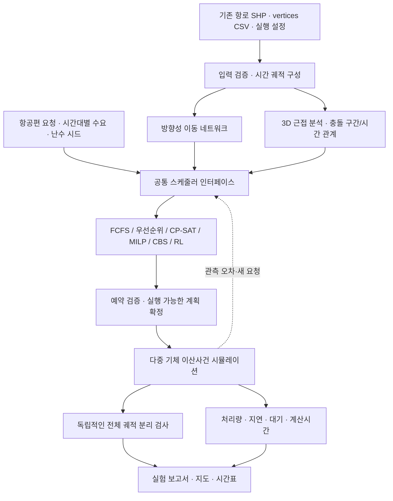

# 고정 항로 기반 다중 기체 운항 네트워크 아키텍처

작성일: 2026-11-05. 이 문서는 **향후 구현 설계**다. 아래 모듈·알고리즘이 이미 구현되었다는 의미는 아니며, 기존 항로 생성 코드와 결과는 입력으로 활용한다.

## 1. 핵심 목표와 권장 접근

**이미 설계한 3차원 STAR/SID 항로에서 다수 항공편의 진입 시각과 충돌 구간 통과 순서를 조정하여, 분리 제약을 만족하면서 지연을 줄이고 처리량을 평가한다.**

- 1차 범위: Inner 항로, 고정 경로·고정 속도 프로파일, 출발/진입 시각 조정.
- 첫 구현: **FCFS 예약 + 다중 기체 이산사건 시뮬레이션**.
- 주 비교 알고리즘: **OR-Tools CP-SAT 공동 스케줄링**. 연속시간 최적화가 필요하면 MILP 비교.
- 후속 연구: **CBS/CCBS**, 대체 항로 선택, 온라인 재계획, 강화학습.
- 평가의 중심: 공간상의 연결 여부에서 **시간당 처리량·지연·분리 위반·오차 대응**으로 확장.

네트워크는 공간·충돌 관계의 표현, 다중 기체 시뮬레이션은 검증 환경, 시간대별 수요는 실험 조건, CBS·강화학습은 의사결정 방법이다. 이들은 서로 대체하는 선택지가 아니다.

### 기존 설계 변경의 맥락

초기 조건을 모두 강제하면 연결 가능한 항로가 크게 줄어들기 때문에 strict와 완화안을 분리했다. 따라서 다음 세 항로망을 비교 대상으로 보존한다.

| 항로망 case | 역할 | 저장된 Inner 결과 |
|---|---|---|
| `strict_no_xy_crossing` | 엄격한 공간 조건의 비교 기준 | 3쌍, STAR/SID 각 3개, Landing_Area 관통·XY 교차 0, 최소 XY 약 162.21m |
| `no_xy_crossing` | Landing_Area 조건을 일부 완화한 비교안 | 4쌍, STAR/SID 각 4개, XY 교차 0, 최소 XY 약 165.10m |
| `vertical_clearance_alternative` | 전체 연결 확보 후 시간 분리 연구의 주 대상 | 8쌍, STAR/SID 각 8개, XY 교차 26쌍, 교점 최소 Z 약 13.52m |

위 수치는 [저장된 Inner 요약](결과물/Inner/optimization_path_reviewed/inside_only/new_options/summary.json)의 실행 사례다. strict의 정의는 Landing_Area 무관통·XY 무교차이며, 모든 입력에 대해 수평 100m·수직 70m를 보장하는 일반 규칙은 아니다. 13.52m 교차부는 연구용 분리 기준에 따라 동시 사용을 제한할 대상으로 모델링한다. 교차 수는 충돌 발생 횟수가 아니다.

## 2. 전체 구조



**스케줄러와 검증기를 분리한다.** 알고리즘이 충돌 없음으로 판정해도 실제 실행 궤적을 별도로 검사한다. 예약 충돌 부재와 물리적 분리 충족을 같은 것으로 간주하지 않는다.

## 3. 입력과 데이터 모델

### 입력 범위

원본 공간자료는 `QGIS/` 아래에 있다. 네트워크 단계의 직접 입력은 그 자료로 생성한 고정 항로 결과다. 1차 기준 디렉터리:

```text
결과물/Inner/optimization_path_reviewed/inside_only/new_options/<항로망 case>/
  combined_routes_z.shp
  selected_routes.csv
  vertices.csv
  route_pair_spacing.csv
  crossing_pair_summary.csv
  crossing_details.csv
```

`crossing_details.csv`는 충돌 분석의 출발 자료이며 전체 충돌 관계를 대체하지 않는다. XY 교차가 없는 근접 구간, 동일 항로 추종, 합류·중첩도 다시 분석한다. 속도·시간은 `vertices.csv`와 설정을 대조하며 일관성이 없으면 궤적을 재구성한다. CRS는 미터 기반 EPSG:5186으로 확인하고 Z의 기준·단위를 기록한다.

| 객체 | 필수 정보 | 의미 |
|---|---|---|
| Route | `route_id`, 운항 종류, FAF 쌍, XYZ, 상대시간, 속도 | 재사용하는 고정 항로 |
| Flight | `flight_id`, `route_id`, 요청 진입 시각, 허용 시간창, 우선순위 | 실제 운항 요청. 동일 항로에 여러 Flight 가능 |
| MovementGraph | 방향성 구간, 연결점, 이동시간 | 실제로 이동 가능한 연결 |
| ConflictRelation | 항로 쌍, 구간 범위, 금지 시간차/점유 관계, 판정 기준 | 동시에 사용할 수 없는 조합 |
| Reservation | 항공편, 자원/충돌 구간, 시작·끝, 확정 여부 | 스케줄러가 생성한 사용 계획 |
| ExperimentConfig | 분리값, 오차, 수요, 시간해상도, 알고리즘, seed | 재현 가능한 실험 조건 |

**XY 교차는 이동 가능한 연결점이 아니다.** 3D 교차·근접은 충돌 관계로 표현하고, 항로 간 전환은 명시적으로 허용한 연결에서만 가능하다. 충돌 그래프의 연결 성분 전체를 단일 배타 자원으로 묶으면 불필요하게 직렬화될 수 있으므로 쌍별 관계를 보존한다.

## 4. 공통 운동·분리 모델

### 고정 궤적과 진입 시각

항공편 i의 궤적을 `x_i(t) = r_i(t - T_i)`로 표현한다. `r_i`는 고정 시간 궤적이고 `T_i`가 결정할 진입 시각이다. 1차 구현은 항로·고도·속도를 바꾸지 않는다.

- SID 대기: 지상 출발 지연으로 모델링.
- STAR 대기: 모델 진입 이전의 시간 조정으로 표현하되 실제 대기 위치·절차는 별도 가정으로 명시.
- 항로 중간 정지·호버링·임의 우회는 기본 행동에 포함하지 않음.
- 실제 공중 대기를 도입할 때는 별도 대기 경로, 에너지, 수용량을 모델에 추가.

### 연구용 분리 규칙

예시로 `수평 거리 < H AND 절대 높이 차 < V`이면 분리 위반으로 정의할 수 있다. H=100m, V=70m는 초기 연구 가정으로 설정 가능하지만, 승인된 운용 기준으로 취급하지 않는다. 이 규칙은 수평·수직을 모두 항상 만족시키는 조건과 다르므로 설정에 논리까지 명시한다.

- `horizontal_threshold_m`, `vertical_threshold_m`, `separation_logic`를 환경 설정으로 분리.
- 위치·고도·시간 오차와 기체 크기를 보호 구간에 어떻게 반영했는지 기록.
- Landing_Area 무관통 조건과 항공기 간 분리는 별도 검사. 시간 예약만으로 고정 장애물 위험이 해결되는 것은 아님.
- Inner 단독 결과를 Outer와 동시에 운용 가능한 결과로 해석하지 않음. 통합 시 교차 네트워크 검사 필요.

### 충돌 구간과 시간 관계

충돌 구간 c의 점유를 `I_ic = [T_i + tau_in_ic, T_i + tau_out_ic]`로 두고, 배타 사용이 필요한 경우 A의 이탈+여유시간 이후 B가 진입하거나 반대 순서를 선택한다. 구간별 예약은 한 항공편 전체에 대해 일관되게 결정한다.

공유 구간 예약은 보수적인 근사다. 정밀 모델은 두 고정 궤적에 대해 분리 위반을 유발하는 **상대 진입 시간차의 금지 구간**을 계산할 수 있다. 시간여유와 보호 구간을 근거 없이 중복 확대하지 않도록 정의를 구분한다.

충돌 검사는 애니메이션 프레임과 독립적으로 수행한다. 선형 시간 궤적 조각은 구간 내 거리 조건을 검사하고, 비선형 속도 프로파일은 근 찾기·오차가 제한된 보수적 세분화 등으로 검사한다. 단순히 매 1초 위치만 비교하여 무충돌을 선언하지 않는다.

## 5. 알고리즘 case별 아키텍처·라이브러리

### Case A — FCFS 예약: 필수 기준선

**목표:** 요청 순서대로 전체 경로가 충돌 없이 사용 가능한 가장 이른 진입 시각을 배정.

1. 요청 시각과 고정된 동점 규칙으로 항공편 정렬.
2. 모든 충돌 구간·동일 항로 추종 관계를 검사.
3. 충돌 시 진입 시각을 뒤로 이동하고 전체 항로 재검사.
4. 실행 가능한 계획을 일괄 예약. 시간창 초과는 거절/미처리로 명시.

| 필요 요소 | 라이브러리·기법 |
|---|---|
| 이벤트와 대기열 | `simpy` 또는 표준 `heapq` 기반 이벤트 큐 |
| 예약 관리 | 정렬된 시간구간 목록, 필요 시 interval tree |
| 계산 | `numpy`, `pandas` |
| 최적화·학습 | 불필요 |

SimPy의 Resource만으로 미래 예약과 전체 경로 일관성이 자동 해결되지는 않으므로 예약 테이블은 별도 구현한다. 장점은 해석·디버깅 용이성, 한계는 선행 요청이 후속 요청을 과도하게 지연시킬 수 있다는 점이다.

### Case B — 우선순위 예약 + Rolling Horizon

**목표:** 접근·출발 비율과 누적 지연을 반영해 온라인 수요에 대응.

- 우선순위 예: 요청 시각, 누적 대기, 운영상 지정한 접근/출발 우선순위.
- starvation 방지를 위해 대기 증가에 따른 우선순위 상승 적용.
- 주기적으로 미래 시간창을 재계획하되, 이미 실행 중이거나 임박하여 확정된 운항은 동결.
- 계획창 경계를 넘어가는 운항의 예약도 유지.

필요 라이브러리: Case A 공통 구성. 기법: 우선순위 큐, aging, rolling horizon. 재계획 주기·계획창·동결창은 실험 변수이며 초기부터 임의의 안전 수치로 고정하지 않는다.

### Case C — 공동 스케줄 최적화: 권장 주 알고리즘

**목표:** 여러 항공편의 진입 시각과 선후관계를 함께 결정하여 총 지연 최소화.

- 변수: 진입 시각, 충돌 구간 선후관계, 필요 시 요청 수락 여부.
- 제약: 요청 이후 진입, 허용 시간창, 고정 이동시간, 충돌 금지, 추종 간격, 자원 용량.
- 목적: 우선 분리 제약 충족 → 운항 수락 수 최대화 → 가중 지연 최소화. 요청을 버려 지연만 낮추는 해를 방지.
- 고정 궤적에서는 각 구간 시작시간을 `T_i + 상대 도달시간`으로 묶어 임의 공중 대기를 막음.

| 선택 | 라이브러리 | 구현 유의점 |
|---|---|---|
| **CP-SAT 권장** | `ortools` | 정수 시간 사용. 예: 정한 tick 단위로 변환하고 점유 구간을 보수적으로 반올림 |
| MILP 비교 | `scipy.optimize.milp` 또는 `pyomo` + `highspy` | 연속 진입 시각과 이진 선후관계. big-M은 시간창에서 유도하여 제한 |

CP-SAT의 interval·NoOverlap은 공유 배타 자원에 적합하다. 부분적으로만 충돌하는 항로들을 하나의 NoOverlap으로 묶으면 과도한 제약이 되므로 쌍별 순서 제약을 사용한다. tick 크기는 계산량·보수성에 영향을 주므로 민감도를 평가한다. solver 시간 제한 시 실행 가능한 incumbent와 최적성 gap/상태를 기록하고, 해를 못 찾은 것과 불가능 판정을 구분한다. [OR-Tools scheduling 문서](https://github.com/google/or-tools/blob/stable/ortools/sat/docs/scheduling.md)

### Case D — CBS/CCBS: 충돌 기반 비교 연구

**목표:** 충돌이 발견된 항공편에 시간 제약을 추가하며 계획을 분기·재탐색.

- 상위 탐색: 충돌 탐지 → A의 해당 시간 행동 제한 / B의 행동 제한으로 분기.
- 하위 탐색: 주어진 제약에서 해당 항공편의 최소 지연 일정 또는 허용된 대체 경로 탐색.
- 고정 항로만 사용하면 하위 문제는 일반적인 공간 경로 찾기보다 실행 가능한 진입 시각 찾기에 가까움.
- 연속시간은 CCBS의 시간구간 제약 개념을 참고. 기체의 3D 분리·가변 속도·대기 제한은 별도 구현.

필요 라이브러리: `heapq`, `dataclasses`, `numpy`; 대체 경로 그래프에 `networkx` 선택 사용. 기법: constraint tree, 충돌 검출, 안전 시간구간 기반 탐색(SIPP 계열, 대기 허용 위치 제한). 범용 라이브러리 설치만으로 항공용 CCBS가 완성되지는 않는다.

CBS는 추가 비교 가치가 있으나 필수 선행 단계는 아니다. 고정 항로·시각 조정만 할 때는 Case C가 더 직접적이다. 대체 항로 선택이 추가되면 CBS의 역할이 커진다. 원 논문의 최적성 보장은 수정한 행동·비용·충돌 모델에 대해 별도로 검토한다. [CBS 원 논문](https://webdocs.cs.ualberta.ca/~nathanst/papers/sharon2015cbsjournal.pdf), [CCBS 개선 논문](https://cdn.aaai.org/ojs/17338/17338-13-20832-1-2-20210518.pdf)

### Case E — 강화학습: 온라인 배정 정책의 후속 확장

**목표:** 변동 수요와 지연 상황에서 다음 항공편·우선순위를 빠르게 선택하는 정책 학습. 첫 구현의 필수 요소는 아니다.

| 항목 | 권장 설계 |
|---|---|
| 에이전트 | 1차는 중앙 스케줄러 1개. 다중 기체 시뮬레이션이 곧 다중 에이전트 RL을 뜻하지 않음 |
| 관측 | 대기 항공편, 요청 시각, 예약 상태, 구간 점유, 누적 지연, 수요 상태 |
| 행동 | 실행 가능한 항공편 선택·우선순위 선택·다음 의사결정까지 보류 |
| 보상 | 처리 완료 보상, 누적 지연·장기 대기 비용. 거절과 지연을 함께 평가 |
| 제약 | 독립 feasibility filter/action mask가 위반 행동 배제. 충돌에 큰 음의 보상만 주어 해결하지 않음 |
| 초기 알고리즘 | 중앙 정책 PPO, 필요 시 MaskablePPO |
| 기준선 | 동일 수요에서 FCFS·우선순위·CP-SAT와 비교 |

필요 라이브러리: `gymnasium`, `stable-baselines3`, `torch`; 행동 마스킹은 `sb3-contrib` 선택. 분산 의사결정이 연구 목적이 될 때 `pettingzoo` 환경 API와 별도의 MARL 학습기를 검토한다. PettingZoo는 학습 알고리즘 자체가 아니며 SB3만으로 일반 MARL이 자동 지원되는 것도 아니다.

학습·검증·평가 시드와 수요 분포를 분리하고, 보지 못한 혼잡도·오차에서 평가한다. 실행 가능한 행동이 없으면 대기/거절/기준 정책으로 복귀한다. 학습 보상 향상은 안전성 증명이 아니며 공통 검증기를 그대로 사용한다. [SB3 PPO 문서](https://stable-baselines3.readthedocs.io/en/master/modules/ppo.html), [PettingZoo](https://github.com/Farama-Foundation/PettingZoo)

## 6. 공통 라이브러리 구성

| 계층 | 라이브러리 | 용도 |
|---|---|---|
| GIS 입력 | `geopandas`, `pyogrio`, `shapely`, 필요 시 `pyproj` | SHP·좌표계·2D 공간 후보 검색 |
| 수치·표 | `numpy`, `pandas`, `scipy` | 시간 궤적·거리·분리 검사·통계 |
| 네트워크 | `networkx` | 방향성 연결과 충돌 관계 분석 |
| 시뮬레이션 | `simpy` | 요청·진입·이탈·재계획 이벤트 |
| 스케줄 최적화 | `ortools` | CP-SAT |
| 시각화 | `matplotlib`, 선택 `plotly` | 시간표·지연 분포·3D 궤적 재생 |
| 검증 | `pytest` | 충돌 검출·예약 불변조건·재현성 테스트 |

Shapely의 평면 공간 연산만으로 3D 분리를 판정하지 않는다. Z와 시간은 수치 모델에서 별도로 처리한다. 모든 case의 라이브러리를 처음부터 설치할 필요는 없다. 최소 구성은 GIS·수치·시뮬레이션·시각화이며, 이후 `ortools`, 마지막에 CBS 구현 또는 RL 의존성을 추가한다. 구현 시 호환 버전을 확인하고 환경 파일에 고정한다.

## 7. 제안 모듈 경계와 출력

아래는 제안 구조이며 아직 생성하지 않는다.

```text
network_system/
  config.py                 # 분리·수요·시간창·오차 설정
  route_loader.py           # SHP/CSV 검증 및 Route 구성
  trajectory.py             # 위치·속도·상대시간 계산
  conflict_builder.py       # 근접 구간·금지 시간차 전처리
  demand.py                 # 동일 seed의 항공편 요청 생성
  reservation.py            # 예약·원자적 확정·취소
  schedulers/
    base.py                 # 공통 입력/출력 계약
    fcfs.py
    priority.py
    cpsat.py
    cbs.py                  # 후속
    rl_policy.py            # 후속
  simulator.py              # 이벤트 실행·실제 상태
  validator.py              # 전체 궤적 분리 독립 검사
  metrics.py
  run_experiment.py
```

스케줄러 공통 계약: `schedule(requests, committed_reservations, model, config)` → 항공편별 배정 시각·거절 사유·계산 상태·계산시간. 알고리즘마다 다른 충돌 판정기를 사용하지 않는다.

실험별 출력: `config.json`, 입력 해시, seed, `flights.csv`, `reservations.csv`, `events.csv`, `separation_violations.csv`, `metrics.json`, 시간표·병목 지도. 계획 시각과 실제 시각을 분리하여 저장한다.

## 8. 실험 case와 완료 기준

| 실험 case | 핵심 검증 | 주 기법 |
|---|---|---|
| 같은 항로에 여러 기체 | 추종 간격·누적 대기 | FCFS + 연속시간 검증 |
| 가까운 두 항로 교차 | 진입 시각으로 분리 위반 해소 | 예약, CP-SAT |
| 여러 교차부를 연속 통과 | 전체 예약 일관성·불가능 순서 배제 | 공동 스케줄링, CBS 비교 |
| 균등·집중·시간대별 수요 | 처리량·병목·접근/출발 편중 | 수요 강도 sweep |
| 출발·속도·위치 오차 | 계획 이탈과 재계획 성능 | rolling horizon, Monte Carlo |
| 대체 항로·동적 수요 | 경로/시간 공동 결정 효과 | CCBS, RL 후속 |

분리 위반 횟수·지속시간, 처리 편수, 요청 수락률, 평균/95백분위 지연, 최대 대기, 계산시간, 병목 점유율을 기록한다. 미처리·거절·실험 종료 후 대기 요청을 빼고 평균을 낮추지 않는다. 종료 후 배출 구간을 두거나 잔여 요청을 명시한다.

strict와 전체 연결안은 **공통 목적지 수요에서의 알고리즘 비교**와 **전체 수요에서의 서비스 범위 비교**를 분리한다. 시나리오·알고리즘 간 동일 요청과 seed를 사용하고 반복 실험의 변동성도 보고한다.

### 권장 구현 순서

1. 항로 입력·시간 궤적·분리 판정기 구현. 교차, 근접 평행, 중첩, 동일 항로, 시간차로 해소되는 사례 검증.
2. FCFS와 예약 기반 다중 기체 시뮬레이션. 미래 전체 경로 예약의 일관성과 시간창 처리 확인.
3. CP-SAT 비교. 같은 수요에서 지연 개선·계산시간·시간해상도 민감도 평가.
4. 시간대별 수요·오차·rolling horizon 확장. 확정 예약 유지와 재계획 실패 시 복귀 검증.
5. 필요에 따라 CBS/CCBS 또는 RL 추가. 기준선 대비 효과가 있는지 평가.
6. Outer 및 FAF 이후 구간은 별도 검증 후 통합. 네트워크 간 충돌과 버티포트 자원까지 확대.

**첫 완료 목표는 “전체 연결 Inner 고정 항로에서 다수 항공편을 FCFS와 CP-SAT로 배정하고, 동일 분리 기준 아래 처리량·지연·위반 여부를 비교하는 재현 가능한 실험”이다.** 실제 운용 적합성 판단은 기체 성능·오차·비정상 절차 등을 포함한 후속 검증과 구분한다.
