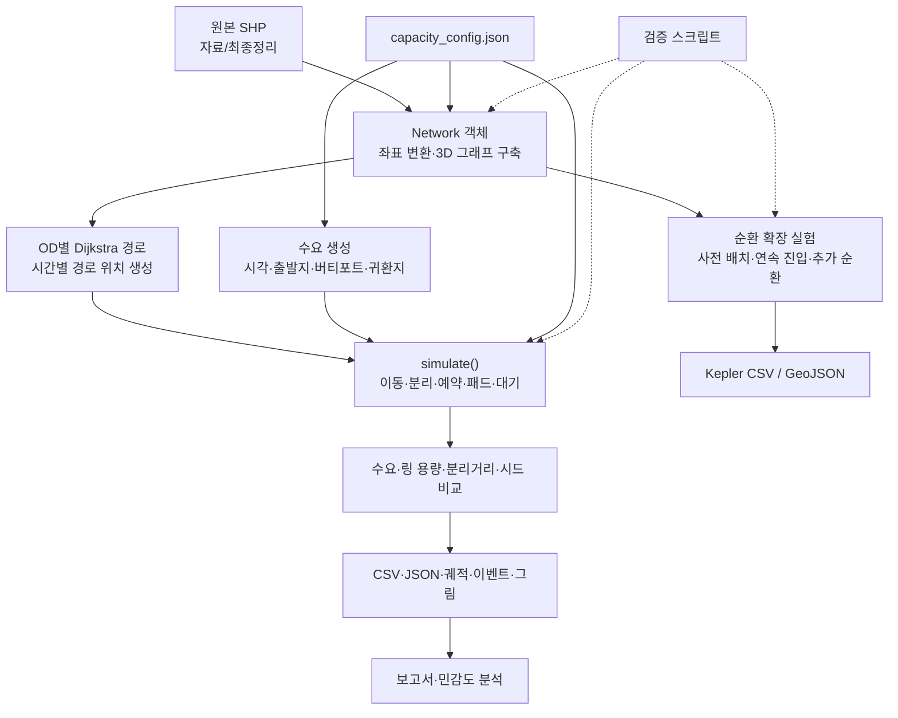

# Network 프로젝트: 핵심 개념과 전체 아키텍처

> 작성일: 2026-10-20  
> 목적: Network 폴더의 항로 구조, 분석 코드, 용량 실험과 결과를 이해하기 위한 학습 문서  
> 확인 범위: README, 과제 정의, 설정 파일, 핵심 코드, 기존 분석 및 순환 확장 보고서와 저장된 결과  
> 수치는 저장된 분석 결과를 기준으로 한다. 이 문서 작성 과정에서 시뮬레이션을 재실행하지 않았다.

## 1. 프로젝트의 목적

이 프로젝트는 **SHP로 정의된 3차원 항로에서 항공기가 접근하고, 착륙하고, 다시 출발하는 과정을 시뮬레이션하여 처리 가능한 수요와 병목을 찾는 연구용 분석 시스템**이다.

전체 구조는 다음 순서로 이해하면 좋다.

1. 항로의 공간 구조
2. 방향성 그래프와 최단시간 경로
3. 기체의 생성·이동·대기·착륙·재출발
4. 분리거리와 자원 예약
5. 수요·링 용량을 바꾸는 실험
6. 처리량과 안정성 평가

**가장 중요한 전제는 “링에 몇 대가 들어가는가”와 “전체 시스템이 시간당 몇 대를 안정적으로 처리하는가”가 서로 다른 문제라는 점이다.**

링에 많은 기체가 있어도 대부분 정지해 있거나 착륙하지 못한다면 전체 운항 시스템의 처리 능력이 높다고 볼 수 없다.

## 2. 항로의 공간 구조

### 2.1 두 개의 순환 링

공간 구조의 중심에는 서로 반대 방향으로 순환하는 두 개의 링이 있다.

- **외곽 링:** 반지름 약 2,800m, 반시계 방향.
- **내곽 링:** 반지름 약 2,000m, 시계 방향.

접근 항로는 외부 출입점에서 기체를 링으로 유도한다. 링 사이에는 Interchange가 있고, 링에서 FAF와 버티포트로 연결되는 항로가 있다. 출발 기체는 연결 항로와 링을 거쳐 외부 출입점으로 나간다.

### 2.2 SHP별 역할

원본 공간자료는 프로젝트의 `자료/최종정리/`에 있다.

| 구성 요소 | 역할 | 주요 특징 |
|---|---|---|
| `접근_start.shp` | 외부 기체가 생성되는 출입점 | `Name` 필드로 식별 |
| `접근.shp` | 출입점에서 외곽 링으로 진입하는 항로 | 도착 기체의 접근 경로 |
| `외곽_2800.shp` | 외곽 순환 항로 | 반시계 방향 |
| `내곽_2000.shp` | 내곽 순환 항로 | 시계 방향 |
| `외곽_IAF_Interchange.shp` | 외곽 링 위의 분기·합류 지점 | 링 간 이동 또는 FAF 연결에 사용 |
| `내곽_Interchange.shp` | 내곽 링의 교차 연결 지점 | 외곽과 연결 |
| `Interchange_In.shp` | 링 사이 연결 항로 | 외곽→내곽 이동에 사용 |
| `Interchange_out.shp` | 링 사이 연결 항로 | 내곽→외곽 이동에 사용 |
| `내곽_IAF.shp` | 내곽에서 FAF로 연결되는 IAF 지점 | 최종접근 연결 |
| `IAF_FAF_In_Update.shp` | 링과 FAF 사이 연결 항로 | 도착 방향 연결 |
| `IAF_FAF_Out_Update.shp` | 링과 FAF 사이 연결 항로 | 출발 방향 연결 |
| `FAF.shp` | 최종접근이 시작되는 지점 | Short Final과 연결 |
| `Short_Final.shp` | FAF와 버티포트 사이 항로 | 코드에서는 도착·출발 양방향으로 사용 |
| `각_건물의_최종_버티포트.shp` | 착륙·지상 체류·이륙 장소 | `fid`로 식별하며 각각 용량 1 |
| `Expert_Off.shp` | 외곽 링에서 외부 출입점으로 나가는 항로 | 출항 경로 |
| `Holding_point.shp` | 진입하지 못한 기체의 대기 자원 | 현재는 실제 비행 궤적 없이 유한 대기열로 관리 |

### 2.3 개념적인 연결 구조

아래는 공간 구조를 단순화한 도식이다. 실제 경로는 SHP의 방향과 접속 관계에 따라 결정된다.

```text
외부 출입점(접근_start)
        │
        ▼
      접근 항로
        │
        ▼
외곽 링(반시계) ──Interchange_In──▶ 내곽 링(시계)
        ▲                              │
        └────────Interchange_out───────┘
        │                              │
        └────── IAF–FAF 연결 항로 ─────┘
                       │
                       ▼
                      FAF
                       ↕ Short Final
                    버티포트
                 착륙·체류·이륙

출항: 버티포트 → 연결 항로 → 링 → 외곽 링 → Expert_Off → 외부 출입점
```

모든 도착 기체가 반드시 내곽 링을 거치는 것은 아니다. 외곽에서 FAF로 직접 연결되는 경로도 있으며, 실제 OD별 경로는 Dijkstra가 선택한다.

## 3. 프로그램 전체 아키텍처

### 3.1 실행 방식

이 시스템은 **Python 스크립트를 실행하여 실험하고 CSV·JSON·그림·보고서를 생성하는 배치 분석 구조**이다.

중심 모듈은 `network_capacity.py`이다. 다른 스크립트는 이 모듈을 재사용하거나 생성된 결과를 가공한다.

### 3.2 데이터 처리 흐름

```text
원본 SHP: 자료/최종정리/          실험 설정: capacity_config.json
              │                              │
              └──────────────┬───────────────┘
                             ▼
                        Network 객체
              좌표 변환·3D 그래프·교차 자원 구성
                             │
                             ▼
                    OD별 Dijkstra 경로
                    시간별 경로 위치 생성
                             │
수요 생성 ───────────────────┤
생성 시각·출발지·목적지·귀환지 │
                             ▼
                         simulate()
              이동·분리·예약·합류·패드·대기 관리
                             │
                             ▼
               수요·용량·분리거리·시드별 비교
                             │
                             ▼
                 CSV·JSON·궤적·이벤트·그림
                             │
                             ▼
                      보고서·민감도 분석

Network 객체 → 순환 확장 실험 → Kepler CSV / GeoJSON

검증 스크립트 → 그래프·운항 규칙·분리·순환 결과 검증
```

### 3.3 주요 코드 파일의 책임

코드 위치는 `Network/코드/`이다.

| 파일 | 담당하는 일 | 읽는 목적 |
|---|---|---|
| `network_capacity.py` | 그래프 구축, 경로 계산, 수요 생성, 운항 시뮬레이션, 조건 비교 | 전체 로직 이해 |
| `capacity_config.json` | 속도, 수요, 시간 간격, 분리거리, 안정 판정 기준 | 실험 가정 확인 |
| `report_capacity.py` | 결과 가공 및 보고서 생성 | 수치가 보고서로 정리되는 방식 확인 |
| `sensitivity_capacity.py` | 시간 간격·속도·지상 체류시간을 바꾸어 비교 | 결과의 가정 민감도 확인 |
| `validate_capacity.py` | 연결성, 충돌 검사, 수요 생성, 패드 점유 등 검증 | 모델이 지켜야 하는 규칙 확인 |
| `circulation_capacity.py` | 링 자체의 순환과 전체 OD 과부하 실험 | 링 용량과 전체 처리량 분리 |
| `validate_circulation.py` | 링 방향, 순환, 과밀 배치, 궤적 등 검증 | 순환 실험의 타당성 확인 |
| `export_kepler_flows.py` | 궤적을 Kepler용 데이터로 변환 | 시뮬레이션 움직임 시각화 |

### 3.4 핵심 객체와 함수

| 객체·함수 | 책임 |
|---|---|
| `Edge` | 방향성 항로 구간, XYZ 좌표, 속도, 이동시간 등을 보관 |
| `Network` | 공간자료를 읽고 노드·간선·OD 경로·교차 자원을 구성 |
| `Network.add_edge()` | 항로를 방향성 간선으로 추가하고 속도 설정 |
| `Network.shortest()` | Dijkstra로 최단시간 경로 계산 |
| `Network.sample()` | 경로를 시간 단계별 위치와 예약 정보로 변환 |
| `demand()` | 기체 생성 시각, 출발지, 버티포트, 귀환 출입점 생성 |
| `Aircraft` | 기체의 현재 경로, 운항 단계, 경로 진행 위치, 대기 상태 관리 |
| `swept_distances()` | 시간 단계 내부의 상대운동 최소거리 계산 |
| `simulate()` | 생성된 수요를 실제 운항시키고 지표·궤적·이벤트 생성 |
| `capacity_expansion_history()` | 한쪽 링씩 1대 증가시키는 재현 가능한 순서 생성 |
| `capacity_scenarios()` | 실제 비교할 분리거리·링 용량 조합 생성 |
| `RingTrack` | 순환 확장 실험에서 링 위의 위치와 기하학적 상한 관리 |
| `preload()` | 기체를 사전 배치한 뒤 계속 순환 가능한지 시험 |
| `feed()` | 외부에서 계속 생성한 기체가 링에 진입하도록 시험 |

## 4. 숙지해야 할 핵심 개념

### 4.1 GIS 좌표계, 기하학, 위상

이 프로젝트는 공간자료를 `EPSG:5186`으로 변환하여 미터 단위로 계산한다. 위치는 `(x, y, z)`로 표현한다.

| 개념 | 의미 |
|---|---|
| 좌표계 | 위치와 거리를 어떤 기준으로 표현할지 결정 |
| 기하학 | 선과 점이 실제로 어디에 있고 어떤 모양인지 표현 |
| 위상 | 어떤 항로에서 어떤 항로로 이동할 수 있는지 표현 |

평면 지도에서 두 항로가 교차하더라도 고도가 다르면 접속점이 아니다. 코드에서는 XYZ 끝점이 0.1m 이내로 일치하는지 확인하며, 링은 실제 접속점에서 구간을 나눈다.

예를 들어 같은 XY 위치를 지나더라도 한 항로가 고도 400m, 다른 항로가 600m라면 그 지점에서 항로를 갈아탈 수 있는 것으로 처리하지 않는다.

**학습 목표:** “이 선들이 교차하는가?”와 “이 선들 사이를 이동할 수 있는가?”를 구분한다.

### 4.2 방향성 그래프

항로를 그래프로 바꾸면 다음과 같이 대응된다.

| 그래프 개념 | 프로젝트에서의 의미 |
|---|---|
| 노드(Node) | 항로 끝점, 접속점, FAF, 버티포트 등 |
| 간선(Edge) | 이동 가능한 방향을 가진 항로 구간 |
| 가중치(Weight) | 항로 구간을 통과하는 데 걸리는 시간 |
| 경로(Path) | 출발지에서 목적지까지 이어지는 간선의 순서 |

방향성이 있으므로 A에서 B로 갈 수 있다고 해서 B에서 A로도 같은 항로를 사용할 수 있는 것은 아니다. 링 방향, In/Out 연결, 양방향으로 만든 Short Final을 구분해야 한다.

### 4.3 Dijkstra와 최단시간 경로

현재 구현은 A*가 아닌 **Dijkstra**를 사용한다.

간선의 가중치는 다음과 같다.

```text
구간 이동시간 = 구간의 3차원 길이 / 구간 속도
t_e = L_e / v_e
```

속도가 kt로 주어지므로 계산할 때 m/s로 변환한다.

```text
1 kt = 1852 / 3600 m/s
```

따라서 거리가 짧은 경로가 항상 선택되는 것은 아니다. 더 긴 경로라도 속도가 충분히 빠르면 이동시간이 짧을 수 있다.

현재 경로는 **혼잡을 반영하지 않은 이동시간**을 기준으로 미리 계산한다. 운항 중 앞이 막히면 기존 경로에서 기다리며, 혼잡에 따른 재경로 탐색은 하지 않는다.

**개별 OD의 최단시간 경로를 구하는 것과 전체 기체를 함께 최적화하여 최대 처리량을 만드는 것은 서로 다른 문제다.**

### 4.4 OD와 수요 생성

OD는 Origin–Destination, 즉 출발지–목적지 조합이다.

기체 한 대에는 다음 정보가 생성된다.

```text
생성 시각 → 외부 출발지 → 착륙할 버티포트 → 재출발 후 나갈 외부 출입점
```

동일 기체가 착륙한 버티포트에서 다시 이륙한다. 귀환 출입점은 최초 출발지와 다를 수 있다.

수요 생성 규칙은 다음과 같다.

- 도착 출발지는 10대 블록마다 강원 1대, 나머지 세 곳 각각 3대가 되도록 섞는다.
- 마지막 불완전 블록에서는 전체 비율이 정확히 일치하지 않을 수 있다.
- 버티포트는 `fid=1`과 가까울수록 선택 확률이 높다.
- 목적지 가중치는 `exp(-d / 500)`이며, 모든 가중치의 합으로 나누어 확률로 사용한다. 여기서 `d`는 fid 1과의 평면거리(m)다.
- 귀환 출입점도 강원 10%, 나머지 각각 30%의 확률로 생성한다.
- 생성 시각은 전체 시간을 구간으로 나눈 뒤 각 구간 안에서 무작위로 정한다. 포아송 도착 과정은 아니다.
- 난수 시드를 고정하여 같은 수요를 재현하고 조건 사이를 비교한다.

`OD.csv`는 도착과 출발을 각각 한 행으로 기록한다. 따라서 전체 행 수를 그대로 기체 수로 해석하면 안 된다.

### 4.5 시간 단계 시뮬레이션과 기체 상태

시뮬레이터는 기본적으로 **1초씩 시간을 진행**한다. 미리 만든 경로상의 위치 배열에서 다음 위치로 진행할 수 있는지 매 단계 판단한다.

기체의 생애주기는 다음과 같다.

```text
수요 생성
    ↓
외부 대기열
    ↓ Holding에 공간이 생기면 이동
Holding 대기열
    ↓ 항로 진입 조건을 만족하면 이동
항로 진입·접근
    ↓
최종접근·20초 호버링
    ↓
착륙·60초 지상 체류
    ↓ 이륙 조건을 만족하면 출발
이륙·출항
    ↓
외부 출입점 도달·왕복 완료
```

다음 위치로의 이동이 막히면 현재 위치에서 기다린다. 코드에서는 공중에 있는 기체도 정지할 수 있다.

**계획된 경로상의 이동과 실제로 허가된 이동의 차이에서 지연과 대기열이 발생한다.**

### 4.6 자원 예약과 우선순위

기체가 사용하는 제한 자원은 다음과 같다.

- 링의 진입 가능 대수
- 교차구간의 독점 예약
- 링 합류 공간
- 버티포트 패드

교차구간은 먼저 예약한 기체가 사용한다. 새 경합에는 대체로 다음 우선순위가 적용된다.

1. 착륙 최종접근
2. 링 진입
3. 기존 항로 유지

동률일 때는 네트워크 진입 시각 등을 사용한다. 기존 예약을 빼앗는 방식은 아니다.

예약은 충돌 회피를 위한 보수적 제어다. 분리거리를 만족하더라도 같은 교차 자원을 동시에 사용할 수 없어 이동이 제한될 수 있다.

### 4.7 교착상태(Deadlock)

교착상태는 서로 상대방이 자원을 놓기를 기다리면서 아무도 진행하지 못하는 상황이다.

예를 들어 다음과 같은 순환 대기가 가능하다.

```text
도착 기체: 교차구간을 확보한 채 패드가 비기를 기다림
출발 기체: 패드에 있는 상태에서 교차구간이 비기를 기다림
```

코드는 이 상황을 줄이기 위해 **최종접근용 교차구간의 예약 전에 착륙 패드도 함께 확보**하도록 구성한다.

출발 기체가 패드에서 100m 이상 벗어나면 다음 패드 예약을 허용한다. 다만 이 예약 순서가 모든 종류의 교착을 제거한다는 의미는 아니다.

### 4.8 충돌 검사와 시간 단계 내부 최소거리

기체는 반경 50m의 3차원 구로 표현한다. 따라서 중심 간 기본 최소거리는 100m다.

링 위의 기체에는 설정된 분리거리 100·250·500·1,000m도 적용한다.

핵심은 **시간 단계의 시작과 끝에서만 거리를 검사하지 않는다는 점**이다. 그 사이의 상대운동에서 가장 가까워지는 거리를 계산한다.

```text
시작 시점: 두 기체가 충분히 멀리 있음
중간 시점: 두 기체가 서로의 이동 경로를 가로지름
종료 시점: 다시 충분히 멀리 있음

시작·종료 거리만 보면 놓칠 수 있으므로 이동 중 최소거리를 검사한다.
```

이 계산은 `swept_distances()`가 담당한다. 다만 각 시간 단계 안에서 이동을 직선으로 근사하며, 실제 가속도와 선회 동작까지 계산하는 비행역학 모델은 아니다.

### 4.9 용량, 점유, 이동, 처리량의 차이

| 개념 | 단위 | 의미 |
|---|---|---|
| 설정 링 용량 | 대 | 모델이 링에 들어가도록 허용한 대수 |
| 기하학적 상한 | 대 | 요구 분리거리를 지키며 원 위에 균등 배치할 수 있는 상한 |
| 관측 점유 대수 | 대 | 실험 중 링이나 항로에 실제로 있었던 대수 |
| 동시 이동 대수 | 대 | 그 순간 실제로 이동한 대수 |
| 도착 수요 | 대/h | 외부에서 새로 생성한 기체 수 |
| 착륙+이륙 처리량 | 회/h | 측정 시간 동안 수행한 착륙과 이륙 횟수의 합 |
| 안정 판정 | 통과/실패 | 완료율·지연·대기열 증가 기준을 모두 만족하는지 |

예를 들어 링에 20대가 있어도 18대가 정지해 있으면 동시 이동은 2대다.

한 시간 동안 착륙 5회와 이륙 5회를 수행했다면 처리량은 10회/h다. 이것이 기체 10대의 왕복 완료를 뜻하지는 않는다. 측정 구간의 시작과 끝에 걸친 운항도 있어 단순히 처리량을 2로 나눈 값이 왕복 완료율과 항상 같지는 않다.

### 4.10 안정성 평가

현재 안정 판정은 다음 세 조건을 모두 요구한다.

| 기준 | 기본 설정 |
|---|---:|
| 평가 대상 기체의 왕복 완료율 | 95% 이상 |
| 완료 기체의 왕복 추가 지연 95백분위 | 300초 이하 |
| 미완료 왕복 대기열의 증가율 | 2대/h 이하 |

왕복 완료는 착륙만이 아니라 재출발 후 외부 출입점에 도달한 상태다.

95백분위 지연은 평가 대상 지연의 약 95%가 그 값 이하라는 의미다. 미완료 기체는 지연 통계에서 제외하지만 완료율 기준에서 반영한다.

기존 90분 실험에서는 다음과 같이 평가 구간을 나눈다.

- 총 운항시간: 5,400초.
- 준비 구간: 앞 1,800초.
- 처리량 측정: 준비 구간 이후.
- 완료율·추가 지연 평가 대상: 준비 구간 이후부터 종료 1,200초 전까지 생성된 기체.
- 대기열 증가율: 준비 구간 이후의 미완료 왕복 대기열 추세로 계산.

종료 직전에 생성되어 정상적으로도 왕복을 끝낼 시간이 부족한 기체가 완료율 평가를 왜곡하지 않도록 구간을 구분한다.

모든 반복이 기준을 만족해야 안정 조건으로 선정한다. 이는 유한 시간 실험의 판정이며, 무한 시간 안정성의 수학적 증명은 아니다.

### 4.11 링의 기하학적 상한

원형 링에서 균등 배치한 인접 기체의 직선거리인 현 길이는 다음과 같다.

```text
d = 2r × sin(π / N)

r: 링 반지름
N: 기체 대수
d: 인접 기체 중심 사이의 직선거리
```

최소 분리거리 `s`를 만족하는 대수 상한은 다음과 같다.

```text
N_max = floor(π / asin(s / (2r)))
```

분리거리 1,000m에서는 내곽 링의 기본 설정 14대를 그대로 허용하지 않고 12대로 제한한다.

이 식은 공간적으로 몇 대를 배치할 수 있는지에 대한 식이다. 그 대수를 실제 접근선에서 진입시키고 착륙·출항까지 원활하게 처리할 수 있다는 보장은 없다.

### 4.12 병목과 가정 민감도

전체 처리량은 가장 제한적인 자원에 영향을 받는다. 링에 여유가 있어도 특정 교차구간이나 패드 앞에 대기가 쌓이면 링 용량을 늘리는 효과가 작을 수 있다.

따라서 혼잡을 분석할 때는 단순 점유 대수와 함께 다음을 확인해야 한다.

- 패드 때문에 막힌 시간 단계 수
- 교차 예약 때문에 막힌 시간 단계 수
- 링 용량 때문에 막힌 시간 단계 수
- 합류 간격이나 분리거리 때문에 막힌 시간 단계 수
- 대기열 증가율
- 완료율과 지연

막힌 시간 단계 수는 지연 원인을 찾는 단서다. 원인들이 서로 영향을 줄 수 있으므로 그 수치 하나만으로 모든 병목의 인과관계를 확정하지는 않는다.

속도, 시간 간격, 지상 체류시간을 바꾸면 결과가 달라질 수 있다. `sensitivity_capacity.py`는 선정 조건을 고정하고 일부 가정을 바꾸어 비교한다. 각 변형에서 최대 용량을 다시 탐색한 실험은 아니다.

## 5. 기존 분석과 순환 확장 실험의 관계

### 5.1 실험마다 답하려는 질문

| 실험 | 핵심 질문 | 포함하는 과정 |
|---|---|---|
| 기존 전체 OD 분석 | 접근·착륙·재출발을 안정적으로 얼마나 처리하는가? | 접근선, 링, 교차 예약, 패드, 지상 체류, 출항 |
| 사전 배치 순환 | 처음부터 링에 배치하면 몇 대가 계속 돌 수 있는가? | 링 위 이동과 분리 검사 |
| 연속 생성 순환 | 외부에서 계속 공급하면 링에 얼마나 진입시킬 수 있는가? | 링 진입과 계속 순환, 외부 대기 |
| 전체 OD 추가 순환 | 추가 바퀴가 실제 운항 구조의 혼잡과 움직임에 어떤 영향을 주는가? | 기존 OD 과정 + 방문 링 추가 순환 |

### 5.2 독립 링 시험의 의미

링 독립 실험은 접근선과 Interchange 이동, 착륙, 링 간 환승을 생략한다. 각 링은 독립적으로 시험한다.

연속 생성 시험에서는 진입한 기체가 종료까지 계속 순환하며 착륙이나 출항으로 빠져나가지 않는다. 공간이 부족하면 새 기체는 외부에서 기다린다.

따라서 순환 대수가 많다는 결과를 전체 OD의 안정 처리량으로 해석하면 안 된다.

### 5.3 추가 순환의 의미

전체 OD 추가 순환 실험은 최단시간 경로에 방문 링마다 추가 0바퀴 또는 2바퀴를 넣어 비교한다.

**추가 2바퀴 경로는 최단시간 경로에 순환을 의도적으로 더한 경로다.** 이 실험은 점유 대수와 실제 이동 대수, 혼잡의 차이를 확인하기 위한 것이다.

## 6. 현재 저장된 결과의 해석

### 6.1 기존 전체 OD 분석

| 항목 | 저장된 결과 |
|---|---:|
| 네트워크 노드 | 68개 |
| 방향성 링크 | 126개 |
| 연결된 도착·출발 OD | 64개 |
| 비교 조건 | 286개 |
| 실험 시간 | 1회 90분, 앞 30분 제외 |
| 시간 간격 | 1초 |
| 반복 수 | 난수 시드 2개 |
| 시험한 수요 중 최대 안정 실제 도착 수요 | 약 4.67대/h |
| 선정 조건의 평균 착륙+이륙 처리량 | 9.0회/h |
| 안정 조건들에서 관측한 최대 동시 체공 | 2대 |

선정 조건은 `S1000_O14_I12`다.

```text
S1000: 링 분리거리 1,000m
O14: 외곽 링 설정 용량 14대
I12: 내곽 링 설정 용량 12대
```

요청 수요가 5대/h여도 90분 동안 생성할 기체 수를 정수로 절삭하므로 실제 생성은 7대이며, 환산한 실제 수요는 약 4.67대/h다.

**안정 조건의 최대 동시 체공 2대는 링이 두 대만 수용할 수 있다는 뜻이 아니다.** 기존 접근·착륙·재출발 정책 아래에서 안정 판정을 통과한 조건의 관측값이다.

전체 조건의 최대 동시 체공 105대에는 혼잡·정체 조건이 포함된다. 이 값을 운영 가능한 용량으로 해석하면 안 된다.

선정한 단일 반복의 완료율 평가 표본은 2대로 작다. 현재 결과는 안정 경계 주변의 수요 세분화, 장시간 운항, 다수 시드 반복으로 보강할 필요가 있다.

### 6.2 링 사전 배치 순환

| 분리거리 | 외곽 링의 검증된 최대 사전 배치 순환 | 내곽 링의 검증된 최대 사전 배치 순환 |
|---:|---:|---:|
| 100m | 175대 | 125대 |
| 250m | 70대 | 50대 |
| 500m | 35대 | 25대 |
| 1,000m | 17대 | 12대 |

처음부터 배치하여 순환할 수 있다는 결과이며, 접근선에서 그 대수까지 채울 수 있다는 뜻은 아니다.

### 6.3 선정된 연속 생성 순환

분리거리 100m, 링별 생성 수요 720대/h인 선정 조건의 결과다.

| 항목 | 외곽 | 내곽 |
|---|---:|---:|
| 생성 기체 | 720대 | 720대 |
| 실제 진입 기체 | 129대 | 96대 |
| 마지막 15분 최소 동시 순환 | 127대 | 96대 |
| 종료 시 외부 대기열 | 591대 | 624대 |

많은 기체가 순환하더라도 외부 대기열이 남으므로 공급 수요를 안정적으로 처리했다고 판단할 수는 없다.

### 6.4 처리량 우선 탐색

별도 추가 탐색에서는 `OD_laps0_R15_O14_I14`, seed `20261020` 조건에서 착륙+이륙 처리량 **25.2회/h**가 보고되었다.

그러나 이 조건은 안정 기준을 만족하지 못했다. 또한 기존 본 분석과 실험 시간·준비 구간이 다르므로 같은 조건의 값처럼 직접 비교하면 안 된다.

**처리량이 가장 큰 조건과 안정적으로 운영 가능한 조건은 구분해야 한다.**

## 7. 설정과 모델 가정

설정 파일은 `Network/코드/capacity_config.json`이다.

### 7.1 기본 설정

| 항목 | 기본값 |
|---|---|
| 난수 시드 | 20261019 |
| 반복 수 | 2 |
| 총 실험 시간 | 5,400초 |
| 준비 구간 | 1,800초 |
| 시간 간격 | 1초 |
| 기체 버퍼 반경 | 50m |
| 링 분리거리 | 100 / 250 / 500 / 1,000m |
| 도착 수요 | 5 / 10 / 15 / 30 / 45 / 60 / 90 / 120 / 180 / 240 / 360대/h |
| 링 용량 체크포인트 | 14 / 28 / 56대, 기하학적 상한도 비교 |
| 도착 호버링 | 20초 |
| 착륙 후 지상 체류 | 60초 |
| 목적지 거리 척도 | 500m |

링 용량은 한쪽씩 1대 증가시키는 난수 순서를 기록하지만, 모든 중간 단계를 시뮬레이션하는 것은 아니다. 지정한 체크포인트와 상한에서 비교한다.

### 7.2 기본 속도

| 항로 | 가정 속도 |
|---|---:|
| 접근 | 90kt |
| Expert_Off | 90kt |
| 외곽 링 | 90kt |
| 내곽 링 | 90kt |
| Interchange_In / out | 60kt |
| IAF_FAF_In / Out | 60kt |
| Short Final | 30kt |

현재 보고서에 따르면 경로 SHP에는 Speed 필드가 없어 위 기본값을 사용한다. Speed 계열 필드가 추가되면 코드가 해당 값을 우선 읽으며 단위는 kt로 가정한다.

### 7.3 모델의 주요 한계

| 항목 | 현재 구현과 해석 |
|---|---|
| 혼잡 대응 | 사전에 계산한 경로에서 기다리며 재경로 탐색은 하지 않음 |
| 공중 정지 | 현재 위치에서 정지 가능 |
| Holding | 유한 대기열로 관리하며 실제 racetrack 위치와 충돌은 계산하지 않음 |
| 비행 성능 | 가감속, 최소 선회반경, 상승·하강률 미반영 |
| 환경·기체 상태 | 바람, 에너지 등 미반영 |
| 교차 예약 | 보수적인 독점 예약이 처리량을 제한할 수 있음 |
| 속도·지상 체류 | 일부 값이 원본 관측값이 아닌 가정 |
| 안정성 표본 | 기존 선정 반복의 평가 표본이 작아 추가 반복 필요 |

현재 수치는 **명시된 운항 정책과 가정 아래에서 얻은 유한 실험 결과**이다. 전역 최적 용량이나 실제 항공기의 인증된 안전 용량으로 해석하지 않는다.

## 8. 결과 파일을 읽는 방법

기본 결과는 `Network/결과물/`, 순환 확장 결과는 `Network/결과물/순환확장/`에 있다.

| 파일 | 확인할 내용 |
|---|---|
| `분석보고서.md` | 기존 분석의 전체 해석과 한계 |
| `summary.json` | 선정 조건과 핵심 지표 |
| `capacity_results.csv` | 조건·시드별 상세 지표 |
| `capacity_summary.csv` | 반복을 통합한 결과 |
| `capacity_bounds.csv` | 분리거리별 안정 수요 비교 |
| `capacity_scenarios.csv` | 실제 시험한 링 용량·분리거리 조합 |
| `capacity_expansion_history.csv` | 재현 가능한 1대 단위 증가 순서 |
| `OD.csv` | 기체별 도착·출발, 계획·실제 시각, 완료·진행·대기 상태 |
| `OD_routes.csv` | OD별 계획 경로와 자유 이동시간 |
| `network_nodes.csv` | 그래프 노드의 XYZ 좌표 |
| `network_edges.csv` | 간선의 방향·길이·속도·시간·속도 출처 |
| `selected_timeline.csv` | 선정 실행의 시간별 기체 수와 대기열 |
| `selected_trajectories.csv` | 선정 실행의 기체별 위치 기록 |
| `selected_events.csv` | 진입·착륙·이륙·이탈 이벤트 |
| `selected_spacing.csv` | 최근접 기체와 실제 간격 |
| `resource_upper_bounds.csv` | 고정 OD 혼합·최소 점유시간에 따른 자원별 평균 부하 상한 |
| `input_audit.csv` | 입력 레이어의 좌표계·필드·개수 등 |
| `source_manifest.csv` | 원본 입력 근거 |
| `validation_summary.json` | 저장된 결과 검증 요약 |
| `effective_config.json` | 해당 실행에 실제 사용한 설정 |

`Network/결과물/검증/`은 짧은 기능 확인용 결과이므로 본 분석 결과와 구분한다.

### 8.1 선정 상태 확인

`summary.json`의 `selection_status`를 먼저 확인한다.

- `stable_tested`: 시험한 조건 중 모든 반복이 안정 기준을 만족하는 조건을 선정함.
- `diagnostic_only_no_stable_condition`: 안정 조건이 없어 혼잡 진단용 조건을 선정함. 이때 선정 결과를 최대 운영 용량으로 쓰지 않음.

### 8.2 Kepler 궤적 파일

| 파일 | 목적 |
|---|---|
| `kepler_ring_flow.csv` | 선정된 독립 링 연속 순환 궤적 |
| `kepler_OD_flow.csv` | 전체 OD에서 동시 이동을 우선하여 선정한 조건의 궤적 |
| `kepler_best_throughput_flow.csv` | 추가 바퀴 없는 조건 중 처리량 최대 조건의 궤적 |
| 같은 이름의 `.geojson` | 시간 좌표를 포함한 Trip 레이어용 데이터 |
| `kepler_ring_paths.csv` | 원본 링 경로 표시 |

위도·경도는 EPSG:4326의 도 단위이며 고도는 원본 Z의 m 단위다. timestamp는 실제 관측 시각이 아니라 2026-10-20 00:00:00 UTC를 시뮬레이션 0초로 둔 가상 시각이다.

점 CSV는 시간별 위치 데이터다. 서로 다른 기체의 점을 하나의 선으로 연결하지 않도록 기체 ID와 시간 순서를 확인한다.

## 9. 추천 학습 순서

### 1단계: README와 과제 정의

프로젝트 목적, SHP 역할, 운항 규칙, 결과 파일을 파악한다.

### 2단계: 공간 구조와 방향성

접근선, 두 링, Interchange, FAF, 버티포트, 출항선의 관계를 그려본다. 고도가 다른 평면 교차가 접속점이 아니라는 점을 확인한다.

### 3단계: 그래프와 경로 계산

다음 순서로 코드를 읽는다.

```text
Network.__init__() → add_edge() → shortest() → sample()
```

SHP가 노드·간선으로 바뀌고, 최단시간 경로와 시간별 위치가 생성되는 과정을 이해한다.

### 4단계: 한 기체의 생애주기

다음 순서로 읽는다.

```text
demand() → Aircraft → simulate()
```

기체 한 대를 골라 생성, 외부 대기, Holding, 진입, 접근, 착륙, 지상 체류, 이륙, 외부 이탈을 따라간다.

### 5단계: 이동이 막히는 이유

패드, 교차 예약, 링 용량, 합류 공간, 분리거리 중 어떤 제약 때문에 다음 위치로 이동하지 못했는지 확인한다.

### 6단계: 조건 비교와 안정 판정

`capacity_scenarios()`와 결과 집계 부분을 읽는다. 분리거리·링 용량·수요·시드를 바꾸어 비교하고, 모든 반복이 안정 기준을 통과해야 선정된다는 점을 확인한다.

### 7단계: 순환 확장 실험

사전 배치, 연속 생성, 전체 OD 추가 순환의 차이를 이해한다. 링 대수와 전체 처리량을 분리해 해석한다.

### 8단계: 검증 코드

`validate_capacity.py`와 `validate_circulation.py`를 읽어 다음 규칙을 확인한다.

- OD가 실제로 연결되는가?
- 링 방향과 XYZ 접속이 맞는가?
- 시간 단계 내부 충돌을 감지하는가?
- 고도가 다른 이동을 올바르게 처리하는가?
- 같은 시드에서 같은 수요가 생성되는가?
- 착륙 이후에만 같은 기체가 이륙하는가?
- 패드 용량과 예약 순서가 지켜지는가?
- 순환 기체가 실제 방향성 링을 따라 움직이는가?
- 과밀 배치가 거부되는가?

### 권장 실습

`OD_routes.csv`로 한 기체의 계획 경로를 확인하고, `selected_events.csv`와 `selected_trajectories.csv`로 실제 운항을 따라간다.

**기체가 기다린 이유를 패드·교차 예약·링 용량·합류·분리거리 중 하나로 설명할 수 있으면 핵심 구조를 이해한 것이다.**

## 10. 실행 명령 참고

아래 명령은 프로젝트 최상위 폴더에서 실행한다. 분석 명령은 결과 파일을 생성하거나 갱신하므로 필요한 경우 별도 출력 폴더를 사용한다.

### 기본 분석

```powershell
python -m pip install -r Network/코드/requirements.txt
python -B -X utf8 Network/코드/validate_capacity.py
python -B -X utf8 Network/코드/network_capacity.py --workers 6
python -B -X utf8 Network/코드/report_capacity.py
python -B -X utf8 Network/코드/sensitivity_capacity.py
```

### 짧은 기능 확인

```powershell
python -B -X utf8 Network/코드/network_capacity.py --quick --output Network/결과물/검증
python -B -X utf8 Network/코드/report_capacity.py --output Network/결과물/검증
```

### 순환 확장과 Kepler 변환

```powershell
python -B -X utf8 Network/코드/validate_circulation.py
python -B -X utf8 Network/코드/circulation_capacity.py --workers 4
python -B -X utf8 Network/코드/export_kepler_flows.py
```

## 11. 이해도 확인 체크리스트

- [ ] 외곽·내곽 링의 방향과 Interchange 역할을 설명할 수 있다.
- [ ] 평면 교차와 3차원 접속의 차이를 설명할 수 있다.
- [ ] 최단거리와 최단시간 경로가 다른 이유를 설명할 수 있다.
- [ ] 혼잡 시 현재 모델이 재경로 탐색을 하는지 설명할 수 있다.
- [ ] 기체 생성부터 왕복 완료까지의 상태를 순서대로 설명할 수 있다.
- [ ] 기체 한 대가 OD.csv에서 도착·출발 두 행으로 기록되는 이유를 안다.
- [ ] 50m 버퍼와 중심 간 100m 분리의 관계를 설명할 수 있다.
- [ ] 시간 단계 내부의 상대운동 최소거리 검사가 필요한 이유를 안다.
- [ ] 패드와 교차구간 사이의 순환 대기를 설명할 수 있다.
- [ ] 설정 용량, 기하학적 상한, 점유 대수, 이동 대수를 구분할 수 있다.
- [ ] 도착 수요, 착륙+이륙 처리량, 왕복 완료를 구분할 수 있다.
- [ ] 현재 안정 판정의 세 가지 기준을 설명할 수 있다.
- [ ] 안정 체공 관측값 2대를 링의 최대 수용 대수로 해석하면 안 되는 이유를 안다.
- [ ] 사전 배치 순환과 실제 진입 가능한 순환 대수가 다른 이유를 안다.
- [ ] 독립 링 결과를 전체 OD 처리량으로 해석하면 안 되는 이유를 안다.
- [ ] 결과에 영향을 주는 속도·체류시간·예약·비행 성능 가정을 설명할 수 있다.

## 12. 참고 파일

아래 경로는 프로젝트 최상위 폴더 기준이다. Notion에는 경로를 기록용으로 보존한다. 원본 파일을 함께 업로드하거나 별도 링크로 연결하지 않으면 Notion에서 로컬 파일이 열리지는 않는다.

- 프로젝트 안내: `Network/README.md`
- 과제 정의: `Network/코드/해야할 과제.md`
- 핵심 구현: `Network/코드/network_capacity.py`
- 실험 설정: `Network/코드/capacity_config.json`
- 기본 검증: `Network/코드/validate_capacity.py`
- 기존 분석보고서: `Network/결과물/분석보고서.md`
- 기존 결과 요약: `Network/결과물/summary.json`
- 기존 결과 검증: `Network/결과물/validation_summary.json`
- 순환 확장 구현: `Network/코드/circulation_capacity.py`
- 순환 확장 검증: `Network/코드/validate_circulation.py`
- 순환분석보고서: `Network/결과물/순환확장/순환분석보고서.md`
- 순환 결과 요약: `Network/결과물/순환확장/summary.json`
- Kepler 사용법: `Network/결과물/순환확장/Kepler_사용법.md`

## 부록: Mermaid 아키텍처 도식

본문의 텍스트 도식은 가져오기 환경과 관계없이 읽을 수 있도록 작성했다. 아래 코드는 Mermaid를 지원하는 편집기에서 구조도로 렌더링할 때 사용할 수 있다.


