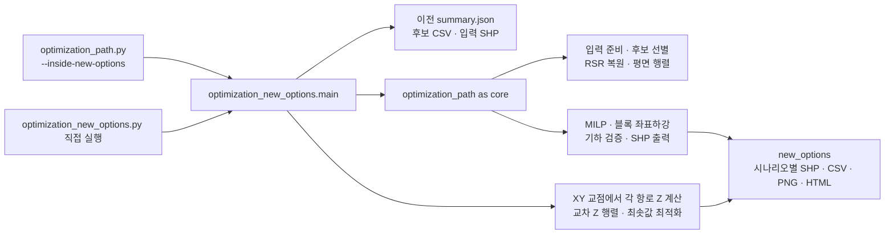
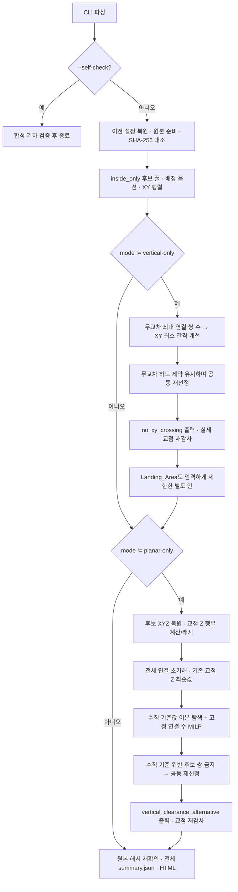

# `optimization_new_options.py` 아키텍처

## 1. 문서의 범위와 근거

이 문서는 **현재 구현의 구조와 동작**을 설명한다. 대상 모듈은 기존 검토 후보에서 링 내부 항로를 재선정하고, **XY 무교차 우선안**과 **XY 교차를 허용하되 교점의 최소 수직 간격을 키운 대안**을 분리해 내보낸다. 새로운 Dubins 후보를 전수 생성하는 모듈은 아니다.[^scope][^bootstrap]

설명은 다음 세 종류의 근거를 구분한다. **코드 각주**는 실제 함수와 줄 위치, **라이브러리 각주**는 공식 API의 의미, **결과 각주**는 저장된 실행 결과의 특정 필드를 가리킨다. 아래 실행 수치는 사례이며 다른 입력에서도 같은 결과가 나온다는 보장이 아니다.[^scope][^snapshot]

검토한 소스의 SHA-256은 다음과 같다. 줄 번호는 이 소스 스냅샷을 기준으로 하므로, 코드를 변경하면 함수 위치와 각주를 함께 갱신해야 한다.[^source-snapshot]

| 파일 | SHA-256 |
|---|---|
| `optimization_new_options.py` | `e89fcf84faa76a099ff3e70d19e444b0e63c1c72de444f48e085627adf0726bd` |
| `optimization_path.py` | `c5381f128846693ad9f0089aa773dc4ee85e96772c9a73a8891cbd0bf92f1f1b` |

## 2. 시스템에서 맡는 역할

`optimization_path.py`가 입력 준비·후보 관리·RSR 복원·MILP·항로 출력의 공통 기능을 제공하고, 이 모듈은 **교점별 Z 계산과 시나리오 실행 순서**를 덧붙인다. 독립적인 기체 동역학 시뮬레이터나 운항 승인 판단기는 아니다.[^core-dependency][^model-scope]



그림의 실행·호출 관계는 실제 진입 분기와 `import optimization_path as core`, `main()`의 호출 순서를 요약한 것이다. 화살표는 별도 서버나 프로세스 간 통신을 뜻하지 않는다.[^entry][^core-dependency][^bootstrap]

### 실행 진입점

권장 진입점은 프로젝트 루트에서 아래 명령을 실행하는 것이다. 상위 스크립트가 `--inside-new-options`를 제거한 뒤 이 모듈의 `main()`에 나머지 인자를 넘긴다.[^entry]

```powershell
python -B "수정본_20261103/코드/optimization_path.py" --inside-new-options
```

직접 실행도 가능하다. 모듈 아래의 `if __name__ == '__main__'` 가드 때문에 `core`로 가져오는 것 자체가 상위 스크립트의 `main()`을 재실행하지는 않는다.[^direct-entry]

```powershell
python -B "수정본_20261103/코드/optimization_new_options.py"
```

## 3. 모듈 경계와 함수별 책임

대상 파일에는 최상위 함수 11개가 있다. 계산·최적화·감사·출력은 논리적으로 구분되지만, 별도 클래스 계층이나 서비스로 분리되지는 않았다.[^functions]

| 계층 | 함수 | 입력 → 출력 / 책임 | 근거 |
|---|---|---|---|
| 경로 표현 | `make_route()` | XYZ 배열 → `xyz`, 누적 XY 길이 `s`, 2D `line` 사전. 자기교차하는 개별 선을 거부 | [^route-model] |
| 높이 조회 | `heights_at()` | 경로 사전·XY 위치 → 그 경로의 Z 배열 | [^interpolation] |
| 교차 분석 | `crossing_height_profile()` | 두 경로 → 최소 절대 Z 차·선택적 상세 기록 | [^intersection] |
| 후보 행렬 | `build_vertical_matrix()` | 후보·경로·평면 교차 행렬 → 대칭 수직 간격 행렬, NPZ 캐시 | [^vertical-matrix] |
| 네트워크 평가 | `network_z_minimum()` | 선정 인덱스·교차/Z 행렬 → 선정 네트워크의 최악 교점 간격 | [^network-minimum] |
| 수직 최적화 | `maximize_crossing_height()` | 전체 연결 초기해 → 수직 최솟값을 키운 선정안·탐색 경계/기록 | [^vertical-search] |
| 최종 감사 | `crossing_audit()` | 선정된 실제 선 → 모든 교점 재계산, CSV·점 SHP·PNG·지표 | [^audit] |
| 시나리오 출력 | `export_case()` | 선정 후보 → `core`의 항로 출력 + 교점 감사 + 시나리오 요약 | [^export] |
| 보고서 | `write_report()` | 전체 요약 → 상대 경로로 결과를 연결하는 HTML | [^html] |
| 자체 검증 | `self_check()` | 합성 선들로 보간·중첩·무교차 등의 결과 확인 | [^tests] |
| 실행 조정 | `main()` | CLI → 입력 검증 → 시나리오 실행 → 전체 요약·보고서 | [^main] |

## 4. 입력 계약과 기존 모델의 상속

### 4.1 파일 입력

이 모듈은 이전 실행의 설정과 검토 후보가 존재한다는 전제에서 시작한다. `core.prepare()`가 원본 공간 자료와 노드를 다시 준비하고, `core.traffic_xyz()`가 필요한 후보의 XYZ를 복원한다. 이때 IAF×FAF×반경 조합을 새로 전수 생성하지는 않는다.[^bootstrap][^reconstruction]

| 입력 | 역할 | 근거 |
|---|---|---|
| `<source>/summary.json` | `Config`, `TrafficConfig`, 원본 입력의 SHA-256 목록 복원 | [^bootstrap] |
| `<source>/review_candidate_metrics.csv` | 기존 후보의 경로 매개변수·형태 통과 여부·Landing_Area 지표 제공 | [^bootstrap][^pool] |
| `<qgis>` 아래 원본 SHP | 링·FAF 쌍·Landing_Area 등 분석 문맥 재구성, 원본 변경 검사 | [^prepare] |
| `<source>/spacing_matrix_inside_only.npz` | 기존 평면 거리/교차 행렬 재사용. 키가 다르면 공통 함수가 재계산 | [^planar-cache] |

기본 `source`는 `수정본_20261103/결과물/optimization_path_reviewed`, 기본 출력은 그 아래 `inside_only/new_options`이다. 공간 원자료의 해시가 이전 요약과 다르면 진행을 중단한다.[^cli][^bootstrap]

### 4.2 조건을 어디에서 가져오는가

350m·속도·구배 등의 값은 이 모듈의 CLI가 새로 정하는 것이 아니라 **이전 `summary.json`의 설정을 복원**해 사용한다. 아래 표는 현재 저장된 설정이며, 코드 기본값과 실행에 실제 복원되는 값은 구별해야 한다.[^bootstrap][^config][^snapshot]

| 현재 조건 | 처리 방식 | 근거 |
|---|---|---|
| 내곽 링 350m, FAF의 `alt` | 이전 설정과 원본 FAF에서 복원. 수직 간격을 위해 Z를 임의로 올리거나 내리지 않음 | [^prepare][^reconstruction] |
| Approach 70→60kt / Departure 60→70kt | 공통 항로 복원·출력 모델 상속 | [^reconstruction][^core-export] |
| CW RSR 및 반대편 FAF 배정 | STAR와 SID를 별도 경로로 복원하고 쌍별 배정 제약 유지 | [^reconstruction][^milp-model] |
| 구배·뱅크·링 내부 제한 | 기존 후보 필터 및 최종 `core.traffic_export()` 검증 상속 | [^pool][^core-export] |
| 총 선회 180°·자기교차 금지 | 검토 후보의 `shape_ok`와 기존 `TrafficConfig` 사용. 180°는 모델 필터이지 규정값이 아님 | [^config][^pool][^model-scope] |
| Landing_Area 우선 회피 | 가능한 FAF 쌍은 관통 금지를 유지하고, 불가능한 쌍만 페널티 후보 사용 | [^pool] |
| 교점의 Z 간격 | 새 고정 하드 기준을 두지 않고 수직 대안에서 최솟값 최대화 | [^vertical-search][^main] |

`Config.vertical_sep_m`에 70이라는 값이 존재해도 이 모듈의 수직 대안에 70m 하드 기준이 생기는 것은 아니다. 실행 요약에는 `hard_vertical_threshold_m=None`을 기록하고, 교차 Z의 탐색값을 사용한다.[^config][^main][^vertical-search]

## 5. 내부 데이터 모델

후보의 **행렬 인덱스**와 원래 `cand_id`, `pair`, `faf_id`, `iaf_id`는 서로 다른 식별자다. `pool`은 선별 후 인덱스를 다시 0부터 붙이며, 출력 CSV의 `route_a/route_b`는 원래 `cand_id`를 기록한다.[^pool][^audit]

| 객체 | 구조 | 의미 | 근거 |
|---|---|---|---|
| `pool` | `pandas.DataFrame`, N행 | 선택 가능한 경로 후보. 행 인덱스가 모든 N×N 행렬 축 | [^pool][^bootstrap] |
| `options` | `{pair: [(STAR_faf, SID_faf), ...]}` | 각 FAF 쌍의 허용 배정 방향 | [^pool] |
| `policy` | 사전 | `strict_pairs`, `penalized_pairs`, 후보 수 등 선별 정책 | [^pool] |
| `route` | `{'xyz', 's', 'line'}` | Nᵥ×3 원본 XYZ, 누적 XY 길이, Z를 제거한 2D 선 | [^route-model] |
| `distance` | N×N 실수 행렬 | 두 중심선의 최소 평면 거리 | [^planar-cache] |
| `crossings` | N×N 불리언 행렬 | XY에서 접촉·교차·중첩하는지. 단순 관통 교차에만 한정하지 않음 | [^planar-cache][^shapely-planar] |
| `gaps` | N×N 실수 행렬 | 목표 평면 간격 부족에 대한 공통 비용 | [^planar-cache] |
| `z_gaps` | N×N 실수 행렬 | 두 후보의 모든 XY 교차 위치 중 최소 절대 Z 차 | [^vertical-matrix] |
| `context` | 7개 원소 튜플 | `(nodes, headings, fafs, areas, audit, config, traffic)` | [^bootstrap][^export] |
| `ids` | 정수 목록 | 선택된 `pool` 행 인덱스. `cand_id` 목록이 아님 | [^milp-model][^audit] |

`z_gaps`의 초기값 `inf`는 무한한 물리적 이격을 측정했다는 뜻이 아니다. 비교할 교점이 없거나, 동시에 선택할 수 없어 계산하지 않은 후보 쌍의 내부 표현이다. 유효한 선택 조합이라는 전제 아래 사용해야 한다.[^vertical-matrix][^network-minimum]

## 6. 전체 처리 흐름



분기는 `main()`의 실제 실행 순서를 나타낸다. 기본 `both`는 우선안·Landing_Area 엄격안·수직 대안의 세 폴더를 만든다. `planar-only`는 앞의 두 안, `vertical-only`는 마지막 안만 실행한다.[^main][^cli]

## 7. 핵심 계산: XY 기하와 원본 Z의 분리

### 7.1 누적 길이에 의한 높이 복원

`make_route()`는 원본 XYZ에서 XY만 사용한 선을 만들고 각 꼭짓점까지의 **누적 평면 선분 길이**를 계산한다. 이것은 후보 생성에 사용한 해석적 원호 길이가 아니라 **저장·복원된 폴리라인의 XY 길이**다.[^route-model]

\[
s_0=0,\qquad
s_k=\sum_{r=1}^{k}\sqrt{(x_r-x_{r-1})^2+(y_r-y_{r-1})^2}
\]

XY 교점 q에 대해 `line_locate_point()`로 선 시작부터의 거리 s(q)를 구하고 `numpy.interp()`로 그 선의 Z를 보간한다. 두 선의 높이는 각각 독립적으로 구한다.[^interpolation][^shapely-locate][^numpy-interp]

\[
z(q)=z_k+\frac{s(q)-s_k}{s_{k+1}-s_k}(z_{k+1}-z_k),
\qquad s_k\le s(q)\le s_{k+1}
\]

\[
\Delta z(q)=|z_A(q)-z_B(q)|
\]

Shapely의 공간 기하 분석은 평면 기준이므로, 교점 기하에 붙은 단일 Z를 두 선의 실제 높이로 대신하지 않는다. 개별 선의 자기교차를 먼저 거부하는 것도 같은 XY에서 어느 경로 위치의 Z를 읽을지 모호해지는 것을 막기 위한 구현 선택이다.[^shapely-planar][^route-model][^intersection]

### 7.2 교점 형태별 처리

`crossing_height_profile()`는 점·선 중첩·복합 기하를 나누어 순회한다. 교점이 여러 개면 가장 작은 차이를 남기며, `details=True`인 경우 각 평가 위치도 반환한다.[^intersection]

| 교차 형태 | 처리 | 근거 |
|---|---|---|
| 교차 없음 | `(inf, [])` 반환 | [^intersection] |
| `Point` | 같은 XY에서 ZA와 ZB를 구해 절대 차 계산 | [^intersection] |
| `MultiPoint` 등 복합 기하 | 각 구성요소를 재귀 순회 | [^intersection] |
| `LineString`·`LinearRing` 중첩 | 중첩 기하의 점과 두 원본 경로의 해당 꼭짓점을 모아 중첩 선 순서로 정렬 | [^overlap] |
| 중첩 중 Z 차의 부호 변화 | 두 평가점 사이에 실제 Z 차가 0인 위치가 있으므로 최솟값을 0으로 갱신 | [^overlap] |

중첩 구간은 양 끝의 높이 차만 보면 안 된다. 두 원본 경로의 꼭짓점에서 구간을 나누면 그 사이의 **부호 있는 높이 차가 선형**이므로, 부호가 바뀌는 위치를 보간해 0m 간격을 검출할 수 있다. 꼭짓점의 중첩 포함 여부를 판별할 때는 `1e-7m` 허용오차를 사용한다.[^overlap]

## 8. 행렬 계산·병렬 처리·캐시

후보 i와 j가 XY에서 만나는 위치 집합을 Iᵢⱼ라 하면, 수직 행렬의 값은 다음과 같다. `build_vertical_matrix()`는 대각선이나 모든 후보 쌍의 상세 기록을 만드는 대신 필요한 후보 쌍의 최솟값만 저장한다.[^vertical-matrix][^intersection]

\[
G_{ij}=\min_{q\in I_{ij}}|z_i(q)-z_j(q)|
\]

계산 대상은 `crossings`의 상삼각 원소 중 **동시에 선택 가능한 후보 쌍**이다. 같은 FAF 쌍에서 같은 운항 방향이거나 같은 FAF를 쓰는 조합은 배정 제약상 함께 선택되지 않으므로 계산에서 제외한다. 동일한 IAF 노드를 공유하는 후보는 공통 링 끝점의 Z가 같아 최소 간격이 0이므로 바로 0을 넣는다.[^vertical-matrix][^milp-model]

작업은 256개 후보 쌍씩 묶어 `ThreadPoolExecutor(max_workers=4)`에 제출한다. 작업자는 `(i, j, gap)` 목록을 반환하고, 실행 조정 스레드가 Gᵢⱼ와 Gⱼᵢ를 함께 기록한다. 이 모듈에서 스레드는 독립 실행 작업을 처리하는 수단이며, 별도 에이전트나 분산 실행 구조는 아니다.[^threading][^python-futures]

| 캐시 | 저장 위치 | 키에 포함되는 것 | 근거 |
|---|---|---|---|
| 평면 행렬 | `<source>/spacing_matrix_inside_only.npz` | 버전 값 1, 복원한 `Config`, 원본 입력 해시, 순서 있는 후보 `cand_id` 목록 | [^cache-key][^planar-cache] |
| 수직 행렬 | `<output>/crossing_z_gaps.npz` | 평면 키에 `:exact-crossing-height-v1`을 결합한 SHA-256 | [^cache-key][^vertical-matrix] |

NPZ를 읽을 때 `allow_pickle=False`를 사용하고 키가 일치할 때만 재사용한다. 다만 **후보 CSV 전체 내용·소스 코드 해시가 키에 직접 들어가지는 않는다.** 후보 ID를 유지한 채 경로 매개변수나 계산 코드를 수동 변경한다면 캐시를 별도로 무효화해야 한다.[^cache-key][^vertical-matrix][^planar-cache]

N개 후보에 대해 행렬 저장 공간은 O(N²)이다. 수직 기하 계산량은 동시에 선택 가능한 XY 교차 후보 쌍 수 E와 각 폴리라인의 기하 연산 비용에 좌우된다. 본문 O(N²) 표기는 배열 형태와 반복 범위에서 도출한 구조 분석이며, 실행 시간 상한을 뜻하지 않는다.[^vertical-matrix][^planar-cache]

## 9. 시나리오 A: 무교차 우선안

첫 단계는 **XY 교차를 금지한 채 완전한 STAR/SID 쌍을 가능한 많이 연결하는 것**이다. 그다음 연결 쌍 수를 유지하며 최소 평면 간격을 개선하고, 마지막 공동 재선정에서 무교차와 확보한 간격 하한을 유지한다. 따라서 모든 FAF 쌍을 반드시 연결하는 문제와는 다르다.[^planar-branch][^milp-model]

공통 MILP의 변수는 후보 선택 xᵢ와 FAF 쌍 선택 yₚ의 이진 변수다. 한 쌍을 선택하면 STAR 하나·SID 하나를 택하고, 두 FAF를 각각 한 번씩 사용한다. 반대편 FAF 배정은 이 제약의 결과다.[^milp-model]

\[
\sum_{i\in STAR(p)}x_i=y_p,\qquad
\sum_{i\in SID(p)}x_i=y_p
\]

\[
\sum_{i\in FAF(p,f)}x_i=y_p
\]

\[
x_i+x_j\le1\quad\text{for forbidden pair }(i,j)
\]

공통 함수는 연결 수를 우선하도록 yₚ에 큰 음의 목적계수를 주고 후보 비용을 작게 정규화한다. `scipy.optimize.milp()`에 이진 범위·정수성·희소 선형 제약을 전달한다. MILP 해의 최적성이 입증되더라도 그것은 전달된 선별 후보와 모델 안의 결과다.[^milp-model][^scipy-milp]

`strict_no_xy_crossing`은 같은 흐름에서 **Landing_Area 관통도 허용하지 않는 쌍**으로 제한한 추가 비교안이다. 기본 `both` 또는 `planar-only` 실행에 함께 생성된다.[^strict-branch]

## 10. 시나리오 B: 전체 연결과 교점 수직 간격

### 10.1 최적화 대상

이 분기는 `options`에 실행 가능한 배정이 있는 FAF 쌍을 모두 유지한다. 즉, 연결 수를 줄여 수직 간격을 좋게 보이는 방식이 아니라 **실행 가능한 전체 연결 수를 고정**한 뒤 교점의 최악 간격을 키운다. 현재 입력에서는 그 수가 8쌍이다.[^vertical-search][^snapshot]

\[
\max_{S}\;g(S),\qquad
g(S)=\min_{\substack{i,j\in S\\C_{ij}=1}}G_{ij}
\]

여기서 C는 실제 XY 교차 행렬이며, 이 식은 평균 간격이 아닌 **최소 간격 최대화(max–min)**를 뜻한다. 교점이 없는 경우는 유한한 최솟값 대신 `inf`로 처리해 별도 상태를 반환한다.[^network-minimum][^vertical-search]

### 10.2 이분 탐색과 MILP의 결합

1. 공통 재선정 함수로 전체 연결 초기해를 얻고 그 교점 최소 간격을 하한 L로 둔다.[^vertical-branch]
2. 상한 U는 `ring_z − min(FAF Z)`로 둔다. 이는 입력 모델의 Z 범위에 근거한 느슨한 상한이다.[^vertical-search][^prepare]
3. 중간값 τ=(L+U)/2에 대해, **교차하면서 Gᵢⱼ가 τ보다 작은 후보 쌍**을 금지한다.[^vertical-search]
4. `required_pairs=count`로 연결 수를 고정한 MILP를 푼다.[^vertical-search][^milp-model]
5. 전체 연결 실행해가 있으면 그 실제 간격으로 L을 올린다. `status_code==2`일 때만 U를 낮춘다.[^vertical-search][^scipy-status]
6. 실행해 없이 시간 제한·기타 상태로 끝나면 불가능하다고 판단하지 않고 탐색을 멈춘다.[^vertical-search][^scipy-status]

금지 행렬은 다음 관계다. 구현에서는 수치 허용오차를 적용하며, 탐색 중에는 `1e-7m`, 후처리에는 `1e-6m`를 사용한다.[^vertical-search][^vertical-branch]

\[
F_{ij}(\tau)=C_{ij}\land(G_{ij}<\tau)
\]

따라서 공통 함수 이름이 `traffic_noncrossing_subset()`이어도 이 분기에 전달하는 행렬은 **모든 XY 교차가 아니라 수직 간격이 부족한 교차**다. 함수 이름만 보고 수직 대안도 XY 무교차라고 해석하면 안 된다.[^vertical-search][^milp-model]

### 10.3 최종 공동 재선정

확보한 수직 하한으로 `forbidden_pairs`를 만들고 공통 `traffic_select()`에 전달한다. **실제 XY 교차 행렬은 비용 계산에**, **수직 하한 위반 행렬은 조합 금지에** 따로 사용한다. 이것이 기존 `forbid_crossings=True`를 수직 대안에서 재사용할 수 있는 핵심 인터페이스다.[^vertical-branch][^conditional-conflicts]

이후 단계는 고도·Z 보간을 조정하지 않고 후보 조합을 바꾼다. 수직 하한을 유지하면서 교차 수·평면 간격 부족·노드 집중·후보 비용을 줄이는 블록 좌표하강법이다. 이 후처리는 전체 조합의 전역 최적화가 아니다.[^conditional-conflicts][^reconstruction]

## 11. 출력과 독립적인 최종 감사

`export_case()`는 먼저 공통 항로 출력기를 호출하고, 그 뒤 선정된 실제 XYZ에 대해 `crossing_audit()`를 다시 실행한다. 후보 행렬의 숫자만 그대로 복사하지 않는다. 수직 대안에서는 이 재계산값이 확보한 수직 하한보다 작으면 실패로 처리한다.[^export][^audit][^vertical-branch]

공통 출력기는 끝점 XYZ·높이 증가/감소 방향·구배·뱅크·진입/합류 방향·선회량·자기교차·링 경계와 저장 후 XYZ를 확인한다. **Approach와 Departure는 별도 LineString Z SHP**이며, 연결 IAF·FAF 점도 따로 저장한다.[^core-export][^point-export]

```text
inside_only/new_options/
├─ summary.json                         # 전체 설정·정책·탐색 기록·결과
├─ report.html                          # 세 시나리오 연결
├─ crossing_z_gaps.npz                   # 후보별 교점 수직 간격 캐시
├─ no_xy_crossing/
├─ strict_no_xy_crossing/
└─ vertical_clearance_alternative/
   ├─ Approach_z.shp (+ .shx/.dbf/.prj/.cpg)
   ├─ Departure_z.shp (+ 동반 파일)
   ├─ combined_routes_z.shp
   ├─ IAF_points_z.shp / FAF_points_z.shp
   ├─ connected_points_z.shp / assigned_faf_z.shp
   ├─ selected_routes.csv / vertices.csv
   ├─ landing_crossings.csv / route_pair_spacing.csv
   ├─ crossing_pair_summary.csv / crossing_details.csv
   ├─ crossing_points_z.shp / crossing_levels_z.shp
   ├─ map_combined.png / map_star.png / map_sid.png
   ├─ view3d.png / profiles.png
   ├─ crossing_z_spacing.png / crossing_vertical_links.png
   └─ summary.json                      # 해당 시나리오의 측정 지표
```

위 트리의 공통 파일은 `core.traffic_export()`가, `crossing_*` 상세 자료와 수직 간격 그림은 `crossing_audit()`가 만든다. 교점이 없으면 교점 CSV는 헤더만 가지며 교점 SHP·수직 간격 전용 PNG는 생성하지 않는다. 따라서 모든 폴더에 트리의 모든 파일이 생기는 것은 아니다.[^core-export][^point-export][^audit][^html]

| 자료 | 해석 시 주의점 | 근거 |
|---|---|---|
| `crossing_pair_summary.csv` | 교차한 **항로 쌍별** 최소 간격과 평가 위치 수 | [^audit] |
| `crossing_details.csv` | 각 평가 위치의 XY, ZA, ZB, 부호 있는 차와 절대 차 | [^audit] |
| `crossing_points_z.shp` | 기하 Z는 두 높이의 **중간값**으로 표시용. 실제 값은 `z_a`, `z_b` 속성 | [^audit] |
| `crossing_levels_z.shp` | 같은 XY에 각 경로의 실제 Z 점 두 개. `route_id`, `role`, `alt`로 구분 | [^audit] |
| 폴더별 `summary.json` | `export_case()`가 계산한 연결 수·교차 수·최소 간격 등 측정 지표 | [^export] |
| 최상위 `summary.json` | 이전 설정, 정책, 입력 해시, 탐색 과정·경계·원본 보존 검사까지 포함 | [^main][^finalization] |

`crossing_levels_z.shp`에는 명시적인 `cross_id`가 없다. 동일 XY에 여러 평가 위치가 있으면 `route_id`·`role`·높이와 상세 CSV를 함께 확인해야 한다. 또한 `planar_crossing_pairs`와 `evaluated_locations`는 각각 항로 쌍 수와 평가 위치 수이므로 같을 필요가 없다.[^audit]

## 12. CLI와 실행 예시

다음 옵션은 이 모듈의 파서가 직접 정의한다. 링 고도나 뱅크각을 바꾸는 옵션은 이 파서에 없으며, 해당 설정은 상위 검토 실행의 요약에서 상속한다.[^cli][^bootstrap]

| 옵션 | 기본값 | 의미 | 근거 |
|---|---|---|---|
| `--source` | `결과물/optimization_path_reviewed` | 이전 검토 요약과 후보 CSV 디렉터리 | [^cli] |
| `--output` | `<source>/inside_only/new_options` | 출력 디렉터리 | [^cli] |
| `--qgis` | `수정본_20261103/QGIS` | 원본 공간 자료 | [^cli] |
| `--search-seconds` | `45.0` | 각 탐색 단계로 전달되는 시간. **전체 프로그램의 실행 시간 상한이 아님** | [^cli][^main][^vertical-search] |
| `--z-tolerance` | `0.5` | 수직 최솟값 탐색의 상·하한 종료 간격(m). 최소 분리 기준이 아님 | [^cli][^vertical-search] |
| `--mode` | `both` | `both`, `planar-only`, `vertical-only` | [^cli][^main] |
| `--self-check` | 꺼짐 | 합성 기하 검증만 수행하고 종료 | [^cli][^tests] |

수직 대안의 각 MILP 질의는 남은 탐색 시간과 6초 중 작은 값을 사용한다. 행렬 계산·SHP 저장·PNG 생성은 이 수직 탐색 타이머에 포함되지 않는다.[^vertical-search][^main]

```powershell
# 두 분기와 Landing_Area 엄격안을 모두 생성
python -B "수정본_20261103/코드/optimization_path.py" --inside-new-options

# 수직 대안만 실행, 탐색 시간·종료 허용 간격 변경
python -B "수정본_20261103/코드/optimization_path.py" --inside-new-options --mode vertical-only --search-seconds 60 --z-tolerance 0.25

# 교점 보간 검증만 실행
python -B "수정본_20261103/코드/optimization_new_options.py" --self-check
```

예제 인자와 분기 동작의 근거는 CLI 정의와 `main()`이다. `--mode`를 바꿔 같은 출력 폴더에 다시 실행하더라도 이전 분기의 폴더를 삭제하지는 않는다. 이번 실행의 활성 결과는 최상위 `summary.json`의 `results`를 기준으로 확인해야 한다.[^cli][^main][^finalization]

## 13. 검증·실패 처리·해석 한계

| 단계 | 현재 확인 또는 실패 조건 | 근거 |
|---|---|---|
| CLI | 시간·허용 간격이 유한한 양수인지 확인 | [^cli] |
| 입력 | 원본 SHP 해시가 이전 요약과 다르면 중단 | [^bootstrap] |
| 개별 경로 | `make_route()`에서 XY 선이 simple인지 확인 | [^route-model] |
| 수직 탐색 초기해 | 실행 가능한 모든 FAF 쌍에 대해 경로 2개씩인지 확인 | [^vertical-search] |
| MILP 실행해 | 반환된 조합이 목표 수직 기준을 실제 만족하는지 재평가 | [^vertical-search] |
| 최종 항로 | 공통 출력기에서 기하 제약·Z 저장 결과 재확인 | [^core-export] |
| 무교차 출력 | 감사 결과 XY 교차가 남으면 중단 | [^planar-branch] |
| 수직 출력 | 감사한 최소 간격이 탐색 하한보다 낮으면 중단 | [^vertical-branch] |
| 종료 | 입력 해시를 다시 비교하고 `original_inputs_unchanged=True` 기록 | [^finalization] |

자체 검증은 50m 차의 단일 교점, 중첩 중 Z 차 0m, 일정한 70m 높이 차, 무교차, 같은 높이 교점을 검사한다. **검증 예제의 70m는 운항 하드 기준이 아니다.** 후보 선정 전체의 정당성이나 실제 비행 안전성을 이 자체 검증 하나로 입증하는 것은 아니다.[^tests][^model-scope]

`make_route()` 자체가 모든 입력 계약을 검사하는 것은 아니다. XYZ의 차원·유한성이나 누적 길이의 엄격한 증가 여부를 별도로 검사하지 않으므로, 정상 후보를 제공하는 상위 모듈에 의존한다. 이 함수를 별도 자료에 재사용할 때에는 자기교차 검사만으로 입력 검증이 완전하다고 보아서는 안 된다.[^route-model][^prepare][^reconstruction]

최적성의 범위는 세 단계로 구분해야 한다. **후보 풀 자체가 선별된 집합**이고, MILP의 증명은 전달된 유한 집합·제약에 관한 것이며, 뒤의 공동 재선정은 휴리스틱이다. 시간 제한을 불가능성으로 해석하거나 결과를 모든 연속 경로의 전역 최적이라고 표현하면 안 된다.[^pool][^milp-model][^conditional-conflicts][^scipy-status]

이 모듈의 보호 장치는 원본 SHP 변경을 확인하지만, 결과 저장 전체를 원자적으로 커밋하는 구조는 아니다. 예외가 중간에 발생하면 일부 출력이나 이전 실행의 결과가 남을 수 있다. 완료 로그와 최상위 요약의 상태를 함께 확인해야 한다.[^bootstrap][^export][^audit][^finalization]

설계상 추가로 주의할 경계는 세 가지다. 첫째, `context`는 위치 기반 튜플이므로 필드 순서 변경이 호출부와 함께 이루어져야 한다. 둘째, `pool` 인덱스와 행렬 축의 순서를 유지해야 한다. 셋째, 보간·교차 계산을 수정할 때에는 수직 캐시의 알고리즘 버전 문자열도 갱신해야 한다. 이는 현재 인터페이스와 캐시 구조에서 도출한 유지보수상의 판단이다.[^export][^cache-key][^vertical-matrix]

## 14. 저장된 실행 사례

현재 저장된 실행은 링 내부·형태·Landing_Area 정책을 적용한 후보 7,816개에서 975개를 선별했다. 아래 표는 이 실행의 `summary.json`에 기록된 값이며 시스템의 고정 반환값은 아니다.[^snapshot]

| 시나리오 | FAF 쌍 | Approach / Departure | XY 교차 쌍 | Landing_Area 관통 | 주요 간격 | 근거 |
|---|---:|---:|---:|---:|---|---|
| `no_xy_crossing` | 4 | 4 / 4 | 0 | 6 | 최소 XY 165.102m | [^snapshot] |
| `strict_no_xy_crossing` | 3 | 3 / 3 | 0 | 0 | 최소 XY 162.206m | [^snapshot] |
| `vertical_clearance_alternative` | 8 | 8 / 8 | 26 | 9 | 교점 최소 Z 13.516m | [^snapshot] |

수직 대안의 교점 평가 위치는 27개다. 탐색 하한은 약 13.516m, 상한은 약 13.989m로 기록되어 `--z-tolerance 0.5` 안에 들어왔으며, 이 표시는 **해당 선별 후보에서 고정된 전체 연결 수를 유지하는 수직 최솟값 탐색**에 한정된다. 실제 운항 분리 충족이나 전역 항로 최적성이라는 뜻은 아니다.[^snapshot][^vertical-search][^model-scope]

---

## 각주와 근거

[^scope]: [optimization_new_options.py](optimization_new_options.py), 모듈 설명 L1–L10 및 `main()` L315–L394. 기존 모델을 유지한 두 시나리오의 재선정이라는 범위를 명시한다.
[^source-snapshot]: 이 문서 작성 시 두 로컬 소스를 SHA-256으로 직접 읽어 확인했다. 대상 파일은 [optimization_new_options.py](optimization_new_options.py) 398줄과 [optimization_path.py](optimization_path.py)이며, 본문 해시는 당시 파일 바이트의 식별값이다. 소스 변경 시 줄 번호와 해시 모두 재검토 대상이다.
[^entry]: [optimization_path.py](optimization_path.py), `main()` L1806–L1812. `--inside-new-options`를 제거하고 `optimization_new_options.main()`으로 분기한다.
[^direct-entry]: [optimization_new_options.py](optimization_new_options.py), L26, L397–L398. 공통 모듈 import와 직접 실행 가드. [optimization_path.py](optimization_path.py)의 최하단에도 직접 실행 가드가 있다.
[^core-dependency]: [optimization_new_options.py](optimization_new_options.py), L26, `main()` L334–L345, L350–L385. 공통 기능을 `core.*` 호출로 사용한다.
[^functions]: [optimization_new_options.py](optimization_new_options.py), 최상위 함수 정의 L29, L38, L44, L101, L139, L147, L185, L242, L254, L296, L315. 표의 계층 구분은 이 구현을 설명하기 위한 문서상의 분류다.
[^route-model]: [optimization_new_options.py](optimization_new_options.py), `make_route()` L29–L35. `np.diff`, `np.linalg.norm`, `np.cumsum`으로 XY 누적 길이를 만들고 `line.is_simple`을 확인한다.
[^interpolation]: [optimization_new_options.py](optimization_new_options.py), `heights_at()` L38–L41. 선상 위치를 누적 거리로 바꾼 뒤 원본 꼭짓점 Z를 보간한다.
[^shapely-planar]: [Shapely 2.1.2 공식 매뉴얼 — Coordinate Systems](https://shapely.readthedocs.io/en/2.1.2/manual.html#coordinate-systems). 공간 기하 분석은 평면 기준이고 Z를 기하 판정에 사용하지 않는다는 설명. 구현은 XY 분석과 Z 보간을 명시적으로 분리한다.
[^shapely-locate]: [Shapely 공식 API — line_locate_point](https://shapely.readthedocs.io/en/stable/reference/shapely.line_locate_point.html). 선 시작으로부터의 거리를 반환하며 선 밖 점은 먼저 선에 투영한다. 이 모듈은 주로 계산된 교점 위치에 사용한다.
[^numpy-interp]: [NumPy 공식 API — numpy.interp](https://numpy.org/doc/stable/reference/generated/numpy.interp.html). 증가하는 표본 위치를 바탕으로 하는 1차원 구간별 선형 보간의 API 근거.
[^intersection]: [optimization_new_options.py](optimization_new_options.py), `crossing_height_profile()` L44–L98. 교차 없음, 점, 복합 기하와 상세 평가 기록 처리.
[^overlap]: [optimization_new_options.py](optimization_new_options.py), 내부 `evaluate()` L56–L77 및 `visit()` L79–L96. 중첩에 속한 두 경로의 꼭짓점을 모으고, 부호 변화 시 0m 차 위치를 계산한다. 본문의 선형성 설명은 이 구간별 선형 보간 구현에서 도출된다.
[^vertical-matrix]: [optimization_new_options.py](optimization_new_options.py), `build_vertical_matrix()` L101–L136. 초기 `inf`, 동시 선택 불가능 조합 제외, 공통 IAF 단축 처리, 대칭 행렬 및 NPZ 저장.
[^threading]: [optimization_new_options.py](optimization_new_options.py), L118–L135. 256쌍 작업 묶음, 최대 4개 스레드, 작업자 반환 후 조정 스레드의 행렬 대입.
[^python-futures]: [Python 3.14 공식 문서 — concurrent.futures](https://docs.python.org/3.14/library/concurrent.futures.html#threadpoolexecutor). `ThreadPoolExecutor`, `submit()`, `as_completed()`의 실행 모델 근거. 이 문서는 특정 기하 연산의 병렬 가속 배율을 보장하지 않는다.
[^network-minimum]: [optimization_new_options.py](optimization_new_options.py), `network_z_minimum()` L139–L144. 선택된 교차 행렬 상삼각에서 유한한 Z 간격의 최솟값을 반환한다.
[^vertical-search]: [optimization_new_options.py](optimization_new_options.py), `maximize_crossing_height()` L147–L182. 고정 연결 수, 하한·상한, 부족 간격 금지 행렬, 최대 6초 MILP 질의, 상태별 경계 갱신, 허용 간격 내 종료 판단.
[^milp-model]: [optimization_path.py](optimization_path.py), `traffic_noncrossing_subset()` L1275–L1342. 후보 x와 FAF 쌍 y의 이진 범위, STAR/SID/FAF 제약, 선택적 `required_pairs`, 금지 후보 쌍 제약 및 희소 MILP 구성. 전달 행렬의 의미는 호출자가 정한다.
[^scipy-milp]: [SciPy 공식 API — scipy.optimize.milp](https://docs.scipy.org/doc/scipy/reference/generated/scipy.optimize.milp.html). 정수성·범위·선형 제약을 가진 혼합정수 선형계획 API이며 HiGHS를 사용한다. 실제 모델식과 목적계수는 공통 소스가 정의한다.
[^scipy-status]: [SciPy 공식 API — milp 반환 상태](https://docs.scipy.org/doc/scipy/reference/generated/scipy.optimize.milp.html). `status=0`은 최적해, `1`은 반복/시간 제한, `2`는 실행 불가능, `3`은 비유계, `4`는 기타 상태다. 대상 함수는 실행해를 먼저 검증하고 `2`일 때만 상한을 낮춘다.
[^audit]: [optimization_new_options.py](optimization_new_options.py), `crossing_audit()` L185–L239. 실제 선정 선 재계산, 교차 쌍/위치 구분, 상세 CSV, 표시용 중간 Z 점과 실제 높이 점, PNG 출력.
[^export]: [optimization_new_options.py](optimization_new_options.py), `export_case()` L242–L251. 위치 기반 `context` 해제, `core.traffic_export()` 호출, 교점 감사, 폴더별 요약 저장.
[^html]: [optimization_new_options.py](optimization_new_options.py), `write_report()` L254–L293. 시나리오별 상대 링크, 교점이 있을 때만 수직 전용 그림 연결, 기하 Z의 의미와 해석 한계 설명.
[^tests]: [optimization_new_options.py](optimization_new_options.py), `self_check()` L296–L312. 합성 예제와 `assert` 검증 범위.
[^main]: [optimization_new_options.py](optimization_new_options.py), `main()` L315–L394. 입력 준비·두 분기·엄격안·출력·종료 처리를 조정한다.
[^cli]: [optimization_new_options.py](optimization_new_options.py), L315–L332. 기본값, `mode` 선택지, 자체 검증 분기, 양수/유한값 검사와 출력 경로 결정.
[^bootstrap]: [optimization_new_options.py](optimization_new_options.py), L333–L348. 설정 복원, 원본 해시 대조, 검토 후보 로딩, 링 내부 후보 풀과 행렬 준비.
[^prepare]: [optimization_path.py](optimization_path.py), `prepare()` L115–L202. EPSG:5186 문맥, 링 노드, FAF alt·쌍과 Landing_Area 대응을 준비하며 FAF가 링보다 높은 경우를 거부한다. 이 모듈은 그 반환값을 상속한다.
[^config]: [optimization_path.py](optimization_path.py), `Config` L59–L84, `TrafficConfig` L820–L833. 기본 수치와 연성 비용·형태 필터 정의. 실제 실행은 이전 요약에서 이 설정을 복원한다.
[^reconstruction]: [optimization_path.py](optimization_path.py), `sample_rsr()` L223–L254 및 `traffic_parameters()`·`traffic_xyz()` L836–L849. STAR/SID 방향을 구분해 원래 매개변수로 XYZ를 복원한다.
[^pool]: [optimization_path.py](optimization_path.py), `traffic_pool()` L985–L1034. 형태·링 내부 필터, 쌍별 Landing_Area 정책, 배정 방향, 상위 후보와 각도 구간별 분산 선별, 인덱스 재부여.
[^planar-cache]: [optimization_path.py](optimization_path.py), `traffic_pair_matrices()` L1037–L1089. 캐시 검증, `1e-8m` 단순화, XY 거리·`intersects` 행렬 및 간격 부족 비용 계산.
[^cache-key]: [optimization_new_options.py](optimization_new_options.py), L341–L344, L373–L374 및 L101–L108. 평면 키 생성, 수직 알고리즘 버전 문자열, NPZ 키 대조.
[^planar-branch]: [optimization_new_options.py](optimization_new_options.py), L349–L362. 최대 연결 수 → 최소 평면 간격 → 무교차 공동 재선정 → 최종 교차 감사 순서.
[^strict-branch]: [optimization_new_options.py](optimization_new_options.py), L363–L370 및 [optimization_path.py](optimization_path.py), `traffic_strict_layout()` L1398–L1421. Landing_Area 관통 없는 쌍에 한정한 무교차 구성.
[^vertical-branch]: [optimization_new_options.py](optimization_new_options.py), L371–L387. 초기해, Z 행렬, max–min 탐색, 수직 부족 금지 행렬을 유지한 후처리 및 출력 검증.
[^conditional-conflicts]: [optimization_path.py](optimization_path.py), `traffic_select()` L1092–L1206, 특히 L1106–L1118과 L1174–L1189. 비용의 실제 교차 행렬과 하드 제약의 `forbidden_pairs`를 분리하며, FAF 쌍 단위 블록 좌표하강을 수행한다.
[^core-export]: [optimization_path.py](optimization_path.py), `traffic_export()` L1452–L1564. 기하 제약 검증, 개별 Approach/Departure Z SHP와 공통 CSV·PNG 출력, 저장 좌표 재검증. 파일 쓰기 API는 [GeoPandas to_file 공식 문서](https://geopandas.org/en/stable/docs/reference/api/geopandas.GeoDataFrame.to_file.html) 및 [Pyogrio write_dataframe 공식 문서](https://pyogrio.readthedocs.io/en/latest/api.html#pyogrio.write_dataframe)를 참고했다.
[^point-export]: [optimization_path.py](optimization_path.py), `write_connection_points()` L1424–L1449 및 호출 L1557. 실제 항로 끝점에서 IAF/FAF Point Z와 연결 식별 속성을 생성한다.
[^finalization]: [optimization_new_options.py](optimization_new_options.py), L388–L394. 마지막 입력 해시 검사, 전체 요약·HTML 저장과 완료 로그. 이 구간에는 원자적 파일 교체나 이전 출력 디렉터리 정리가 구현되어 있지 않다.
[^model-scope]: [optimization_new_options.py](optimization_new_options.py), 모듈 설명 L1–L10 및 HTML 설명 L275–L291. 기존 조건·형태 필터 유지, 70m 하드 기준 미적용, 시간·풍향·기체 성능과 운항 안전성 판정의 비포함 범위를 명시한다.
[^snapshot]: [저장된 new_options/summary.json](../결과물/optimization_path_reviewed/inside_only/new_options/summary.json)의 `policy`와 `results`. `policy`의 후보 수 7,816/975, 세 결과의 연결 수·XY/Z 간격·Landing_Area 관통 수, 수직 대안의 `evaluated_locations=27`, `vertical_search.floor_m=13.515732907681667`, `upper_bound_m=13.989313992858238`, `tolerance_m=0.5`, `optimal_to_tolerance_in_shortlist=true`를 직접 확인했다.
